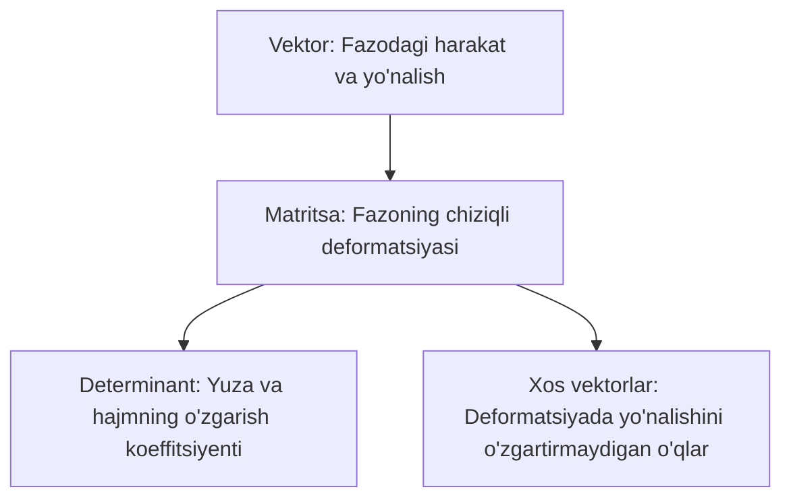

## Kirish: Formulalar ortidagi go'zallik va vizual falsafa

Aksariyat talabalar chiziqli algebrani faqat quruq sonlar jadvali, matritsalarni ko'paytirish va determinant hisoblashning mexanik qoidalari deb tasavvur qilishadi. Bu fanning tub mohiyatini anglashga to'sqinlik qiladi.

Mashhur Garvard va MIT professori **Gilbert Strang** ta'kidlaganidek: *"Chiziqli algebra — formulalarni yodlash emas, balki fazoni ko'ra bilish san'atidir"*.

Keling, ushbu modul davomida o'rgangan barcha asosiy tushunchalarimizning **geometrik mohiyatini** bitta umumiy manzarada jamlaymiz.

---

## 1. 4 ta asosiy tushunchaning geometrik talqini

### 1. Vektor nima?
- **Algebraik:** Sonlarning tartiblangan ro'yxati: $\vec{v} = (x_1, x_2, \dots, x_n)^T$.
- **Geometrik:** Fazodagi boshlang'ich nuqtadan siljish yo'nalishi va masofasi.
- **Kompyuter fanida:** Ma'lumotlar atributi (masalan, foydalanuvchining qiziqishlari, matn embeddingi yoki rasm piksellari).

### 2. Matritsa nima?
Matritsani quruq sonlar to'plami deb emas, balki **fazoning chiziqli dinamik o'zgarishi (transformatsiyasi)** deb tushunish kerak.
Matritsaning ustunlari — bu standart bazis vektorlarining ($\vec{i}, \vec{j}, \vec{k}$) transformatsiyadan keyingi yangi tushgan joyidir!
$$
A = \begin{pmatrix} a & b \\ c & d \end{pmatrix} \implies \vec{i} \to \begin{pmatrix} a \\ c \end{pmatrix}, \quad \vec{j} \to \begin{pmatrix} b \\ d \end{pmatrix}
$$
Siz matritsaga qaraganingizda fazo qanchalik burilganini va cho'zilganini darhol ko'rishingiz mumkin.

### 3. Determinant nima?
Determinant — bu transformatsiya natijasida **yuza (2D) yoki hajm (3D) necha marta o'zgarganini ko'rsatuvchi masshtab koeffitsiyenti**dir!
- Agar $\det A = 3$ bo'lsa, fazodagi ixtiyoriy figura yuzi transformatsiyadan keyin roppa-rosa 3 barobar kattalashadi.
- Agar $\det A = 0$ bo'lsa, fazo bitta o'lchamini yo'qotadi (butun tekislik bitta to'g'ri chiziqqa, yoki butun 3D fazo bitta tekislikka siqilib qoladi). Natijada siqilgan fazodan orqaga qaytib bo'lmaydi — **teskari matritsa mavjud emas**!
- Agar $\det A < 0$ bo'lsa, fazo nafaqat ko'lamini o'zgartirgan, balki ko'zgudek teskari o'girilgan (fazoviy oriyentatsiya o'zgargan).

### 4. Xos sonlar va xos vektorlar nima?
Fazo matritsa ta'sirida burilganda va cho'zilganda ko'pchilik vektorlar o'z yo'nalishini o'zgartiradi.
Lekin ba'zi noyob yo'nalishlar borki, ular **o'z yo'nalishini mutlaqo o'zgartirmaydi**, faqatgina cho'ziladi yoki siqiladi!
Ushbu o'zgarmas o'qlar — **XOS VEKTORLAR**, ularning cho'zilish koeffitsiyenti esa **XOS SONLAR** ($\lambda$) dir:
$$
A \vec{v} = \lambda \vec{v}
$$

---

## 2. Chiziqli algebraning zamonaviy texnologiyalardagi o'rni

Bugungi kunda chiziqli algebra dunyodagi eng ilg'or sohalarning yuragi hisoblanadi:

1. **Sun'iy intellekt va Katta Til Modellari (LLM / Transformers):**
   GPT, Gemini va Claude kabi neyron tarmoqlarining asosi bo'lgan **Self-Attention** mexanizmi to'liq matritsaviy ko'paytmalarga tayanadi:
   $$
   \operatorname{Attention}(Q, K, V) = \operatorname{softmax}\left(\frac{Q K^T}{\sqrt{d_k}}\right) V
   $$
2. **Google Qidiruv Tizimi (PageRank algoritmi):**
   Internetdagi milliardlab veb-sahifalarning nufuzini aniqlash ulkan matritsaning eng katta xos soniga mos keluvchi dominant xos vektorini topishga asoslangan.
3. **Kompyuter grafikasi va O'yin industriyasi:**
   3D modellarni ekranda burish, yoritish va kamerani harakatlantirish $4 \times 4$ gomozen matritsalar orqali GPU video kartasida soniyasiga milliardlab marta hisoblanadi.
4. **Ma'lumotlar tahlili va SVD / PCA:**
   Minglab o'lchamli katta ma'lumotlarni muhim axborotini yo'qotmasdan 2D yoki 3D ga tushirish (asosiy komponentlar tahlili — PCA) xos vektorlar va kovariatsiya matritsasining spektral tahlili yordamida amalga oshiriladi.
5. **Kvant kompyuterlari:**
   Kubitlar holati kompleks fazodagi unitar operatorlar va Gilbert fazosidagi matritsalar bilan tavsiflanadi.

---

## 3. Chiziqli algebrani chuqur o'rganish uchun eng yaxshi adabiyotlar

Agar siz ushbu fan bo'yicha bilimlaringizni xalqaro standartlar darajasida mustahkamlamoqchi bo'lsangiz, quyidagi oltin manbalarni tavsiya etamiz:

### 1. Vizual va intuitiv manbalar:
- **3Blue1Brown — "Essence of Linear Algebra" (YouTube):** Dunyodagi eng chiroyli va tushunarli animatsion kurs. Har bir tushunchaning geometriyasini ko'z oldingizda jonlantiradi.
- **Mathprofi.ru (Aleksandr Yemelin):** Oliy matematikaning amaliy jihatlarini "choynaklar" uchun oddiy, do'stona va qadamma-qadam uslubda tushuntirgan eng mashhur amaliy portal.

### 2. Xalqaro OTM darsliklari:
- **Gilbert Strang — "Introduction to Linear Algebra" (MIT):** Dunyo bo'ylab eng ko'p o'qitiladigan klassik darslik. MIT OpenCourseWare dagi ma'ruzalari bilan birga o'rganish tavsiya etiladi.
- **Sheldon Axler — "Linear Algebra Done Right":** Determinantlarga haddan tashqari bog'lanmasdan, vektor fazolar va operatorlarning haqiqiy algebratik go'zalligini ochib beruvchi nazariy durdona.

### 3. Milliy va klassik akademik manbalar:
- **Sh.A. Ayupov, B. Omirov, A. Xudoyberdiyev — "Algebra va sonlar nazariyasi":** O'zbekiston Milliy universiteti va oliy ta'lim muassasalari talabalari uchun chuqur nazariy qo'llanma.
- **D.V. Beklemishev — "Курс аналитической геометрии и линейной алгебры":** MFTI (MIPT) ning eng nufuzli talabalari tayyorlanadigan qat'iy va chuqur akademik kurs.
- **I.V. Proskuryakov — "Сборник задач по линейной алгебре":** Amaliy hisoblash ko'nikmalarini mukammal darajaga yetkazish uchun 2000 dan ortiq tipik va olimpiada darajasidagi masalalar to'plami.

---

## 4. Chiziqli algebra modulining yakuniy xulosasi

Siz chiziqli algebraning eng muhim bosqichlarini muvaffaqiyatli bosib o'tdingiz:
- Matritsalar va Determinantlardan boshlab;
- Chiziqli tenglamalar sistemalarini Gauss, Kramer va Matritsa usullarida yechish;
- Chiziqli fazolar, bazislar va koordinatalarni almashtirish;
- Xos sonlar, xos vektorlar va operatorlar nazariyasi;
- Kvadratik formalarni ortogonal bosh o'qlarga keltirish va Simpleks optimallashtirish usuli!

Ushbu poydevor sizga keyingi barcha modullarni — **Ko'p o'zgaruvchili funksiyalar, Karrali integrallar, Differensial tenglamalar sistemalari hamda Ehtimollar nazariyasi va Matematik statistikani** oson va chuqur o'zlashtirishda mustahkam tayanch bo'lib xizmat qiladi.
