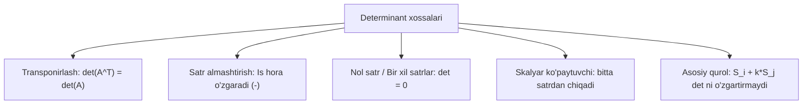

## Kirish: Qanday qilib yirik determinantlarni qo'lda 1 daqiqada hisoblash mumkin?

Oldingi darsda ko'rganimizdek, agar determinantda nollar ko'p bo'lsa, Laplas teoremasi bo'yicha hisoblash juda osonlashadi.
Lekin agar matritsada birorta ham nol bo'lmasa-chi? Masalan, barcha elementlari katta sonlardan iborat bo'lsa?

Bu yerda bizga **determinantlarning 10 ta xossasi** yordamga keladi. Biz bu xossalar yordamida o'zimiz istagan joyda nollarni sun'iy ravishda "yasab olamiz" va matritsani uchburchak shaklga keltirib, bosh diagonal elementlarini bir-biriga ko'paytirib qo'yamiz!

---

## 1. Determinantning 10 ta fundamental xossasi

1. **Transponirlash xossasi:** Matritsa transponirlansa, uning determinanti zarracha o'zgarmaydi:
   $$
   \det(A^T) = \det(A)
   $$
   *Natija:* Satrlar uchun o'rinli bo'lgan barcha xossalar va qoidalar ustunlar uchun ham 100% to'g'ridir!

2. **Satrlar o'rnini almashtirish:** Agar determinantning ixtiyoriy ikkita satri (yoki ustuni) o'rni almashtirilsa, determinantning **ishorasi qarama-qarshisiga o'zgaradi**:
   $$
   \begin{vmatrix} a & b \\ c & d \end{vmatrix} = - \begin{vmatrix} c & d \\ a & b \end{vmatrix}
   $$

3. **Nol satr xossasi:** Agar biror satr (yoki ustun) to'liq nollardan iborat bo'lsa, determinant **$0$ ga teng**.

4. **Bir xil satrlar xossasi:** Agar determinantda kamida ikkita bir xil satr (ustun) bo'lsa, determinant **$0$ ga teng**.

5. **Proporsional satrlar xossasi:** Agar ikkita satr bir-biriga proporsional bo'lsa (ya'ni bir satr ikkinchisining $k$ karralisi bo'lsa), determinant **$0$ ga teng**.

6. **Umumiy ko'paytuvchini chiqarish:** Biror satrdagi (ustundagi) umumiy ko'paytuvchini determinant belgisidan tashqariga chiqarish mumkin:
   $$
   \begin{vmatrix} k \cdot a_{11} & k \cdot a_{12} \\ a_{21} & a_{22} \end{vmatrix} = k \cdot \begin{vmatrix} a_{11} & a_{12} \\ a_{21} & a_{22} \end{vmatrix}
   $$
   > [!WARNING] Diqqat!
   > Matritsani songa ko'paytirishda barcha elementlar ko'paytiriladi: $\det(k \cdot A) = k^n \cdot \det A$ ($n$-tartibli matritsa uchun). Determinantda esa faqat bitta satrga ta'sir qiladi!

7. **Qo'shiluvchilarga ajratish:** Agar biror satr elementlari ikki son yig'indisidan iborat bo'lsa, determinant ikki determinant yig'indisiga ajraladi:
   $$
   \begin{vmatrix} a_1 + b_1 & a_2 + b_2 \\ c_1 & c_2 \end{vmatrix} = \begin{vmatrix} a_1 & a_2 \\ c_1 & c_2 \end{vmatrix} + \begin{vmatrix} b_1 & b_2 \\ c_1 & c_2 \end{vmatrix}
   $$

8. **ENG MUHIM XOSSA (Nollash quroli):** Agar biror satrga boshqa satrning ixtiyoriy $k$ songa ko'paytirilgani qo'shilsa, **determinantning qiymati mutlaqo o'zgarmaydi**:
   $$
   S_i \to S_i + k \cdot S_j \implies \det A_{\text{yangi}} = \det A
   $$

9. **Ko'paytma determinanti:** Ikki kvadrat matritsa ko'paytmasining determinanti ularning determinantlari ko'paytmasiga teng:
   $$
   \det(A \cdot B) = \det(A) \cdot \det(B)
   $$

10. **Uchburchak matritsa determinanti:** Agar bosh diagonaldan pastdagi (yoki yuqoridagi) barcha sonlar $0$ bo'lsa, determinant shunchaki **bosh diagonal elementlarining ko'paytmasiga** tengdir:
    $$
    \begin{vmatrix}
    d_1 & * & * & * \\
    0 & d_2 & * & * \\
    0 & 0 & d_3 & * \\
    0 & 0 & 0 & d_4
    \end{vmatrix} = d_1 \cdot d_2 \cdot d_3 \cdot d_4
    $$

---

## 2. Vandermond determinanti

Matematika va fizika olimpiadalarida hamda interpolyatsiya masalalarida mashhur **Vandermond determinanti** uchraydi:

$$
V_n(x_1, x_2, \dots, x_n) = \begin{vmatrix}
1 & x_1 & x_1^2 & \dots & x_1^{n-1} \\
1 & x_2 & x_2^2 & \dots & x_2^{n-1} \\
\vdots & \vdots & \vdots & \ddots & \vdots \\
1 & x_n & x_n^2 & \dots & x_n^{n-1}
\end{vmatrix} = \prod_{1 \le i < j \le n} (x_j - x_i)
$$

$3 \times 3$ holatida:
$$
\begin{vmatrix}
1 & a & a^2 \\
1 & b & b^2 \\
1 & c & c^2
\end{vmatrix} = (b - a)(c - a)(c - b)
$$

---

## 3. Qadamma-qadam to'liq yechilgan amaliy misollar

### 1-misol: $4 \times 4$ determinantni uchburchak shaklga keltirish

**Masala:** Ushbu determinantni xossalar yordamida uchburchak ko'rinishga keltirib hisoblang:
$$
\Delta = \begin{vmatrix}
1 & 2 & 3 & 4 \\
2 & 5 & 2 & 1 \\
3 & 4 & 1 & -2 \\
4 & 3 & -1 & 1
\end{vmatrix}
$$

#### Yechish:

**1-qadam. 1-ustunni tozalaymiz ($a_{11} = 1$ yordamida):**
- $S_2 - 2S_1 \to S_2$: $(0, \; 5 - 4 = 1, \; 2 - 6 = -4, \; 1 - 8 = -7)$
- $S_3 - 3S_1 \to S_3$: $(0, \; 4 - 6 = -2, \; 1 - 9 = -8, \; -2 - 12 = -14)$
- $S_4 - 4S_1 \to S_4$: $(0, \; 3 - 8 = -5, \; -1 - 12 = -13, \; 1 - 16 = -15)$

Matritsa ko'rinishi:
$$
\Delta = \begin{vmatrix}
1 & 2 & 3 & 4 \\
0 & \mathbf{1} & -4 & -7 \\
0 & -2 & -8 & -14 \\
0 & -5 & -13 & -15
\end{vmatrix}
$$

**2-qadam. 2-ustunni tozalaymiz ($a_{22} = 1$ yordamida):**
- $S_3 + 2S_2 \to S_3$: $(0, \; 0, \; -8 + 2(-4) = -16, \; -14 + 2(-7) = -28)$
- $S_4 + 5S_2 \to S_4$: $(0, \; 0, \; -13 + 5(-4) = -33, \; -15 + 5(-7) = -50)$

Matritsa:
$$
\Delta = \begin{vmatrix}
1 & 2 & 3 & 4 \\
0 & 1 & -4 & -7 \\
0 & 0 & -16 & -28 \\
0 & 0 & -33 & -50
\end{vmatrix}
$$

3-satrdan $(-4)$ umumiy ko'paytuvchini chiqaramiz (6-xossa):
$$
\Delta = -4 \cdot \begin{vmatrix}
1 & 2 & 3 & 4 \\
0 & 1 & -4 & -7 \\
0 & 0 & \mathbf{4} & 7 \\
0 & 0 & -33 & -50
\end{vmatrix}
$$

**3-qadam. 3-ustunni tozalaymiz:**
4-satrga 3-satrning $\frac{33}{4}$ barobarini qo'shamiz ($S_4 + \frac{33}{4} S_3$):
$$
-50 + \frac{33 \cdot 7}{4} = \frac{-200 + 231}{4} = \frac{31}{4}
$$

Matritsa to'liq yuqori uchburchak ko'rinishga keldi:
$$
\Delta = -4 \cdot \begin{vmatrix}
\mathbf{1} & 2 & 3 & 4 \\
0 & \mathbf{1} & -4 & -7 \\
0 & 0 & \mathbf{4} & 7 \\
0 & 0 & 0 & \mathbf{\frac{31}{4}}
\end{vmatrix}
$$

**4-qadam. Diagonal elementlarni ko'paytiramiz (10-xossa):**
$$
\Delta = -4 \cdot \left( 1 \cdot 1 \cdot 4 \cdot \frac{31}{4} \right) = -4 \cdot 31 = -124
$$

**Javob:** $\Delta = -124$.

---

### 2-misol: Xossalar orqali hisoblashni soddalashtirish

**Masala:** Ushbu determinantni hisoblang:
$$
\Delta = \begin{vmatrix}
100 & 102 & 104 \\
200 & 202 & 204 \\
300 & 302 & 304
\end{vmatrix}
$$

#### Yechish:
Katta sonlarni to'g'ridan-to'g'ri ko'paytirish shart emas!
1. 1-ustunni 2- va 3-ustunlardan ayiramiz:
   - $U_2 - U_1 \to U_2$: $(102-100=2, \; 202-200=2, \; 302-300=2)$
   - $U_3 - U_1 \to U_3$: $(104-100=4, \; 204-200=4, \; 304-300=4)$

$$
\Delta = \begin{vmatrix}
100 & 2 & 4 \\
200 & 2 & 4 \\
300 & 2 & 4
\end{vmatrix}
$$
Diqqat qiling: 3-ustun 2-ustunning roppa-rosa 2 barobari ($U_3 = 2 U_2$)!
5-xossaga ko'ra, ikkita ustuni proporsional bo'lgan determinant **har doim 0 ga teng**:
$$
\Delta = 0
$$

**Javob:** $\Delta = 0$.

---

## 4. Talabalar yo'l qo'yadigan tuzoqlar

> [!WARNING] Imtihonda ehtiyot bo'ling!
> 1. **Satrlar o'rnini almashtirganda minusni yo'qotish:** 1-satr va 2-satr o'rnini almashtirsangiz, determinant oldiga albatta **minus ($-$)** chiqishi shart!
> 2. **Satrni songa ko'paytirish va qo'shish farqi:**
>    - $S_1 \to S_1 + 2S_2$ amali determinantni o'zgartirmaydi;
>    - Lekin agar 1-satrning o'zini 2 ga ko'paytirsangiz ($S_1 \to 2S_1$), butun determinant 2 marta kattalashadi! Shuning uchun tenglik saqlanishi uchun oldiga $\frac{1}{2}$ ko'paytuvchi qo'yish kerak.
> 3. **Chiziqli kombinatsiyada aylanma sikl hosil qilish:** Bir vaqtning o'zida ham $S_1 \to S_1 + S_2$, ham $S_2 \to S_2 + S_1$ qilib bo'lmaydi (bunday almashtirish determinantni 0 ga aylantirib qo'yishi mumkin). Har bir qadamda bitta boshqaruvchi pivot satrdan foydalaning.

---

## 5. Mustaqil yechish uchun amaliy mashqlar

1. Uchburchak shaklga keltirib hisoblang:
   $\Delta = \begin{vmatrix} 2 & 4 & 6 \\ 1 & 3 & 5 \\ 1 & 1 & 4 \end{vmatrix}$.
   - *Javob:* $\Delta = 6$.

2. Vandermond formulasi bilan hisoblang:
   $\Delta = \begin{vmatrix} 1 & 2 & 4 \\ 1 & 3 & 9 \\ 1 & 5 & 25 \end{vmatrix}$.
   - *Javob:* $(3 - 2)(5 - 2)(5 - 3) = 1 \cdot 3 \cdot 2 = 6$.
