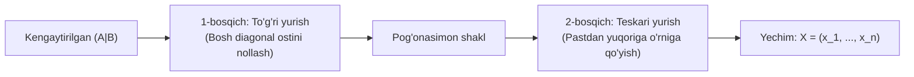

## Nega Gauss usuli — Chiziqli Algebraning "Shohi"?

Kramer qoidasi va Matritsa usullari juda chiroyli va ixcham. Biroq ularning jiddiy cheklovlari bor:
1. Ular **faqat kvadrat ($n \times n$)** sistemalarga qo'llanadi (tenglamalar soni noma'lumlar soniga teng bo'lishi shart);
2. Ular **faqat asosiy determinant $\det A \neq 0$** bo'lgandagina ishlaydi.

Agar tenglamalar soni noma'lumlar soniga teng bo'lmasa-chi (masalan, 3 ta tenglama va 4 ta noma'lum)? Yoki $\det A = 0$ bo'lib, sistema cheksiz ko'p yechimga ega bo'lsa-chi? Bunday holatda Kramer va Matritsa usullari mutlaqo ojiz qoladi!

Mana shunday vaziyatda maydonga **Buyuk Karl Fridrix Gauss usuli** chiqadi.
Gauss usuli:
- Har qanday to'rtburchak ($m \times n$) o'lchamli sistemaga ishlaydi;
- Yechim yo'qligini darhol fosh qiladi ($0 = b$ ziddiyati);
- Yagona yechimni ham, cheksiz ko'p yechimlarni ham birday aniqlik bilan topadi!

---

## 1. Gauss usulining 2 ta asosiy bosqichi

### 1-bosqich: To'g'ri yurish (Прямой ход)
Kengaytirilgan $(A \mid B)$ matritsani elementar satr almashtirishlari yordamida **yuqori uchburchak yoki pog'onasimon (trapetsiyasimon)** ko'rinishga keltirish (bosh diagonal tagidagi barcha elementlarni ketma-ket nolga aylantirish).

### 2-bosqich: Teskari yurish (Обратный ход)
Pog'onasimon matritsani qaytadan tenglamalar sistemasiga aylantirib, eng oxirgi sodda tenglamadan boshlab noma'lumlarni ketma-ket pastdan yuqoriga qarab topish.

---

## 2. Qadamma-qadam to'liq yechilgan 3 ta namunaviy misol

### 1-namuna: Yagona yechimga ega sistema

**Masala:** Gauss usulida yeching:
$$
\begin{cases}
2x_1 - x_2 + 3x_3 = 9 \\
x_1 + 2x_2 - x_3 = -2 \\
3x_1 + x_2 + x_3 = 4
\end{cases}
$$

#### Yechish:

**1-bosqich: To'g'ri yurish:**
Kengaytirilgan matritsani yozamiz. Hisoblash oson bo'lishi uchun 1- va 2-satrlar o'rnini almashtiramiz (chunki 2-satrda $x_1$ koeffitsiyenti $1$ ga teng!):
$$
(A \mid B) = \left(\begin{array}{ccc|c}
2 & -1 & 3 & 9 \\
1 & 2 & -1 & -2 \\
3 & 1 & 1 & 4
\end{array}\right) \sim \left(\begin{array}{ccc|c}
\mathbf{1} & 2 & -1 & -2 \\
2 & -1 & 3 & 9 \\
3 & 1 & 1 & 4
\end{array}\right)
$$

1-satr yordamida 1-ustunni tozalaymiz:
- $S_2 - 2S_1 \to S_2$: $(0, \; -1 - 4 = -5, \; 3 - (-2) = 5, \; 9 - (-4) = 13)$
- $S_3 - 3S_1 \to S_3$: $(0, \; 1 - 6 = -5, \; 1 - (-3) = 4, \; 4 - (-6) = 10)$

Matritsa:
$$
\sim \left(\begin{array}{ccc|c}
1 & 2 & -1 & -2 \\
0 & -5 & 5 & 13 \\
0 & -5 & 4 & 10
\end{array}\right)
$$

3-satrdan 2-satrni ayiramiz ($S_3 - S_2 \to S_3$):
- $0 - 0 = 0; \quad -5 - (-5) = 0; \quad 4 - 5 = -1; \quad 10 - 13 = -3$.

Matritsa pog'onasimon shaklga keldi:
$$
\left(\begin{array}{ccc|c}
\mathbf{1} & 2 & -1 & -2 \\
0 & \mathbf{-5} & 5 & 13 \\
0 & 0 & \mathbf{-1} & -3
\end{array}\right)
$$

**2-bosqich: Teskari yurish:**
Tenglamalarni pastdan yuqoriga qarab yechamiz:
1. 3-tenglamadan:
   $$
   -x_3 = -3 \implies \mathbf{x_3 = 3}
   $$
2. 2-tenglamaga $x_3 = 3$ ni qo'yamiz:
   $$
   -5x_2 + 5(3) = 13 \implies -5x_2 + 15 = 13 \implies -5x_2 = -2 \implies \mathbf{x_2 = 0.4}
   $$
3. 1-tenglamaga $x_2$ va $x_3$ ni qo'yamiz:
   $$
   x_1 + 2(0.4) - 3 = -2 \implies x_1 + 0.8 - 3 = -2 \implies x_1 - 2.2 = -2 \implies \mathbf{x_1 = 0.2}
   $$

**Javob:** $x_1 = 0.2, \; x_2 = 0.4, \; x_3 = 3$.

---

### 2-namuna: Cheksiz ko'p yechimli sistema (Erkin o'zgaruvchilar)

**Masala:** Ushbu sistemani Gauss usulida yeching:
$$
\begin{cases}
x_1 + 2x_2 - 3x_3 + 2x_4 = 1 \\
2x_1 + 5x_2 - 5x_3 + 3x_4 = 4 \\
x_1 + 3x_2 - 2x_3 + x_4 = 3
\end{cases}
$$

#### Yechish:

**To'g'ri yurish:**
$$
\left(\begin{array}{cccc|c}
1 & 2 & -3 & 2 & 1 \\
2 & 5 & -5 & 3 & 4 \\
1 & 3 & -2 & 1 & 3
\end{array}\right)
$$
1-satr yordamida 1-ustunni tozalaymiz:
- $S_2 - 2S_1 \to S_2$: $(0, \; 1, \; 1, \; -1, \; 2)$
- $S_3 - S_1 \to S_3$: $(0, \; 1, \; 1, \; -1, \; 2)$

$$
\sim \left(\begin{array}{cccc|c}
1 & 2 & -3 & 2 & 1 \\
0 & 1 & 1 & -1 & 2 \\
0 & 1 & 1 & -1 & 2
\end{array}\right)
$$
3-satrdan 2-satrni ayiramiz ($S_3 - S_2 \to S_3$):
$$
\sim \left(\begin{array}{cccc|c}
\mathbf{1} & 2 & -3 & 2 & 1 \\
0 & \mathbf{1} & 1 & -1 & 2 \\
0 & 0 & 0 & 0 & 0
\end{array}\right)
$$

Nolli satrni o'chirib tashlaymiz.
Rang $\operatorname{rank} = 2$, noma'lumlar $n = 4$. Sistema **cheksiz ko'p yechimga ega**!

**Teskari yurish:**
- Bazis o'zgaruvchilar: $x_1, x_2$;
- Erkin o'zgaruvchilar: $x_3 = c_1, \; x_4 = c_2$ ($c_1, c_2 \in \mathbb{R}$).

2-tenglamadan:
$$
x_2 + c_1 - c_2 = 2 \implies \mathbf{x_2 = 2 - c_1 + c_2}
$$
1-tenglamaga qo'yamiz:
$$
x_1 + 2(2 - c_1 + c_2) - 3c_1 + 2c_2 = 1
$$
$$
x_1 + 4 - 2c_1 + 2c_2 - 3c_1 + 2c_2 = 1 \implies x_1 + 4 - 5c_1 + 4c_2 = 1
$$
$$
\mathbf{x_1 = -3 + 5c_1 - 4c_2}
$$

**Umumiy yechim:**
$$
X = \begin{pmatrix} -3 + 5c_1 - 4c_2 \\ 2 - c_1 + c_2 \\ c_1 \\ c_2 \end{pmatrix} = \begin{pmatrix} -3 \\ 2 \\ 0 \\ 0 \end{pmatrix} + c_1 \begin{pmatrix} 5 \\ -1 \\ 1 \\ 0 \end{pmatrix} + c_2 \begin{pmatrix} -4 \\ 1 \\ 0 \\ 1 \end{pmatrix}
$$

---

### 3-namuna: Birgalikda bo'lmagan (yechimga ega bo'lmagan) sistema

**Masala:** Tenglamalar sistemasini yeching:
$$
\begin{cases}
x_1 + x_2 - x_3 = 2 \\
2x_1 + 2x_2 - 2x_3 = 7 \\
3x_1 - x_2 + 2x_3 = 5
\end{cases}
$$

#### Yechish:
Kengaytirilgan matritsa:
$$
\left(\begin{array}{ccc|c}
1 & 1 & -1 & 2 \\
2 & 2 & -2 & 7 \\
3 & -1 & 2 & 5
\end{array}\right)
$$
2-satrdan $2 \times (\text{1-satr})$ ni ayiramiz:
$$
2 - 2 = 0; \quad 2 - 2 = 0; \quad -2 - (-2) = 0; \quad 7 - 4 = \mathbf{3}
$$
Matritsada quyidagi satr paydo bo'ldi:
$$
\begin{pmatrix} 0 & 0 & 0 & \bigm| & 3 \end{pmatrix}
$$
Bu tenglama $0 \cdot x_1 + 0 \cdot x_2 + 0 \cdot x_3 = 3$, ya'ni **$0 = 3$** degan ma'nosiz ziddiyatni anglatadi!

**Javob:** Sistema birgalikda emas, yechimga ega emas ($\emptyset$).

---

## 3. Talabalar yo'l qo'yadigan tuzoqlar

> [!WARNING] Imtihonda ehtiyot bo'ling!
> 1. **Boshqaruvchi element (Pivot) $0$ bo'lib qolishi:** Agar nollash paytida diagonalda $0$ turgan bo'lsa, pastdagi noldan farqli satr bilan o'rnini almashtiring! Hech qachon nolga bo'lishga urinmang.
> 2. **Satrlarni ko'paytirishda ishoralarni adashtirish:** $S_3 - 3S_1$ amalini bajarayotganda barcha elementlarni, ayniqsa ozod hadlarni ham 3 ga ko'paytirishni unutmang.
> 3. **Ustunlar o'rnini almashtirish xatosi:** Tenglamalar sistemasini yechayotganda ustunlarni almashtirish taqiqlanadi (chunki noma'lumlar almashib ketadi). Faqat satrlar bilan ishlang!

---

## 4. Mustaqil yechish uchun amaliy mashqlar

Gauss usuli bilan yeching:
1. $\begin{cases} x_1 + 2x_2 + 3x_3 = 14 \\ 3x_1 + 2x_2 + x_3 = 10 \\ x_1 + x_2 + x_3 = 6 \end{cases}$
   - *Javob:* $x_1 = 1, \; x_2 = 2, \; x_3 = 3$.

2. $\begin{cases} x_1 + 2x_2 - x_3 = 3 \\ 2x_1 + 4x_2 - 2x_3 = 6 \end{cases}$
   - *Javob:* Cheksiz ko'p yechim: $x_1 = 3 - 2c_1 + c_2, \; x_2 = c_1, \; x_3 = c_2$.
