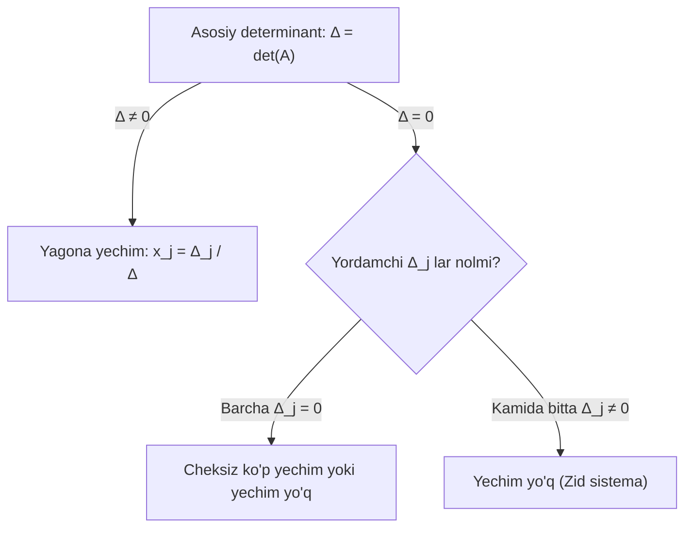

## Kirish: Shveysariyalik Gabriel Kramerning buyuk kashfiyoti

1750-yilda shveysariyalik matematik **Gabriel Kramer** chiziqli tenglamalar sistemasini har xil noqulay almashtirishlarsiz, **to'g'ridan-to'g'ri determinantlar nisbati orqali** yechishning ajoyib analitik formulasini e'lon qildi.

Bu usul talabalar orasida eng mashhur va eng sevimlisidir! Chunki bu yerda murakkab eliminatsiya (yo'qotish) amallari talab qilinmaydi — faqatgina bir nechta determinantlarni hisoblab, ularni bir-biriga bo'lish kifoya.

---

## 1. Kramer qoidasi qachon ishlaydi?

Kramer qoidasini qo'llash uchun ikkita qat'iy shart bajarilishi shart:

> [!IMPORTANT] Kramer usulining 2 ta majburiy talabi
> 1. **Kvadrat sistema:** Tenglamalar soni noma'lumlar soniga teng bo'lishi shart ($n \times n$ sistema);
> 2. **Nolmas determinant:** Sistemaning asosiy determinanti noldan farqli bo'lishi shart:
>    $$
>    \Delta = \det A \neq 0
>    $$

---

## 2. Kramer formulalari va geometrik mohiyati

Agar $\Delta = \det A \neq 0$ bo'lsa, sistemaning yagona yechimi quyidagi formulalar bilan topiladi:

$$
x_1 = \frac{\Delta_1}{\Delta}, \quad x_2 = \frac{\Delta_2}{\Delta}, \quad \dots, \quad x_n = \frac{\Delta_n}{\Delta}
$$

bu yerda:
- **$\Delta$ (Asosiy determinant):** Noma'lumlar oldidagi koeffitsiyentlardan tuzilgan determinant;
- **$\Delta_j$ (Yordamchi determinant):** Asosiy determinantdagi $j$-ustun o'rniga **ozod hadlar ustuni ($B$)** qo'yilgan determinant.

### Geometrik ma'nosi:
- **2D tekislikda ($2 \times 2$ sistema):** Ikkita to'g'ri chiziqning kesishishi.
  * $\Delta \neq 0$: Chiziqlar bitta nuqtada kesishadi (yagona yechim).
  * $\Delta = 0, \Delta_x \neq 0$: Chiziqlar o'zaro parallel (kesishmaydi, yechim yo'q).
  * $\Delta = 0, \Delta_x = \Delta_y = 0$: Chiziqlar ustma-ust tushadi (cheksiz ko'p yechim).
- **3D fazoda ($3 \times 3$ sistema):** Uchta tekislikning fazodagi o'zaro joylashuvi. $\Delta \neq 0$ bo'lganda uchala tekislik bitta umumiy nuqtada kesishadi.

---

## 3. Agar $\Delta = 0$ bo'lsa nima bo'ladi?

> [!CAUTION] Nolga bo'lish xavfi!
> Agar asosiy determinant $\Delta = 0$ bo'lsa, Kramer formulasidagi maxraj nolga aylanadi:
> 1. Agar barcha yordamchi determinantlar ham nolga teng bo'lsa ($\Delta_1 = \Delta_2 = \dots = \Delta_n = 0$), sistema **cheksiz ko'p yechimga ega** bo'lishi mumkin (yoki yechimga ega emas).
> 2. Agar yordamchi determinantlardan kamida bittasi noldan farqli bo'lsa (masalan, $\Delta_1 \neq 0$), sistema **umuman yechimga ega emas**!
> 
> $\Delta = 0$ holatida Kramer usulidan darhol voz kechib, **Gauss usuli** yoki **Kronekker-Kapelli teoremasi**ga o'tish zarur!

---

## 4. Qadamma-qadam to'liq yechilgan amaliy misollar

### 1-misol: $2 \times 2$ sistemani Kramer qoidasi bilan yechish

**Masala:** Sistemani yeching:
$$
\begin{cases}
3x_1 + 4x_2 = 18 \\
5x_1 - 2x_2 = 4
\end{cases}
$$

#### Yechish:
1. Asosiy determinant:
   $$
   \Delta = \begin{vmatrix} 3 & 4 \\ 5 & -2 \end{vmatrix} = 3(-2) - 4(5) = -6 - 20 = -26 \neq 0
   $$
2. Yordamchi determinant $\Delta_1$ (1-ustun o'rniga ozod hadlar):
   $$
   \Delta_1 = \begin{vmatrix} \mathbf{18} & 4 \\ \mathbf{4} & -2 \end{vmatrix} = 18(-2) - 4(4) = -36 - 16 = -52
   $$
3. Yordamchi determinant $\Delta_2$ (2-ustun o'rniga ozod hadlar):
   $$
   \Delta_2 = \begin{vmatrix} 3 & \mathbf{18} \\ 5 & \mathbf{4} \end{vmatrix} = 3(4) - 18(5) = 12 - 90 = -78
   $$
4. Noma'lumlarni topamiz:
   $$
   x_1 = \frac{\Delta_1}{\Delta} = \frac{-52}{-26} = 2
   $$
   $$
   x_2 = \frac{\Delta_2}{\Delta} = \frac{-78}{-26} = 3
   $$

**Javob:** $x_1 = 2, \; x_2 = 3$.

---

### 2-misol: 3 noma'lumli ChTS ni Kramer usulida to'liq yechish

**Masala:** Tenglamalar sistemasini Kramer usulida yeching:
$$
\begin{cases}
2x - y + z = 2 \\
3x + 2y + 2z = -2 \\
x - 2y + z = 1
\end{cases}
$$

#### Yechish:

**1-qadam. Asosiy determinant $\Delta$ ni hisoblaymiz:**
$$
\Delta = \begin{vmatrix}
2 & -1 & 1 \\
3 & 2 & 2 \\
1 & -2 & 1
\end{vmatrix}
$$
Sarryus qoidasi bo'yicha:
$$
\Delta = [2 \cdot 2 \cdot 1 + (-1) \cdot 2 \cdot 1 + 3 \cdot (-2) \cdot 1] - [1 \cdot 2 \cdot 1 + (-1) \cdot 3 \cdot 1 + (-2) \cdot 2 \cdot 2]
$$
$$
\Delta = [4 - 2 - 6] - [2 - 3 - 8] = [-4] - [-9] = -4 + 9 = 5
$$
$\Delta = 5 \neq 0$. Sistema **yagona yechimga ega**!

---

**2-qadam. $\Delta_x$ ni hisoblaymiz (1-ustunga ozod hadlarni qo'yamiz):**
$$
\Delta_x = \begin{vmatrix}
\mathbf{2} & -1 & 1 \\
\mathbf{-2} & 2 & 2 \\
\mathbf{1} & -2 & 1
\end{vmatrix}
$$
$$
\Delta_x = [2 \cdot 2 \cdot 1 + (-1) \cdot 2 \cdot 1 + (-2) \cdot (-2) \cdot 1] - [1 \cdot 2 \cdot 1 + (-2) \cdot 2 \cdot 2 + (-1) \cdot (-2) \cdot 1]
$$
$$
\Delta_x = [4 - 2 + 4] - [2 - 8 + 2] = 6 - (-4) = 10
$$

---

**3-qadam. $\Delta_y$ ni hisoblaymiz (2-ustunga ozod hadlarni qo'yamiz):**
$$
\Delta_y = \begin{vmatrix}
2 & \mathbf{2} & 1 \\
3 & \mathbf{-2} & 2 \\
1 & \mathbf{1} & 1
\end{vmatrix}
$$
$$
\Delta_y = [2(-2)(1) + 2(2)(1) + 3(1)(1)] - [1(-2)(1) + 1(2)(2) + 3(2)(1)]
$$
$$
\Delta_y = [-4 + 4 + 3] - [-2 + 4 + 6] = 3 - 8 = -5
$$

---

**4-qadam. $\Delta_z$ ni hisoblaymiz (3-ustunga ozod hadlarni qo'yamiz):**
$$
\Delta_z = \begin{vmatrix}
2 & -1 & \mathbf{2} \\
3 & 2 & \mathbf{-2} \\
1 & -2 & \mathbf{1}
\end{vmatrix}
$$
$$
\Delta_z = [2(2)(1) + (-1)(-2)(1) + 3(-2)(2)] - [1(2)(2) + (-2)(-2)(2) + 3(-1)(1)]
$$
$$
\Delta_z = [4 + 2 - 12] - [4 + 8 - 3] = -6 - 9 = -15
$$

---

**5-qadam. Noma'lumlarni hisoblaymiz:**
$$
x = \frac{\Delta_x}{\Delta} = \frac{10}{5} = 2
$$
$$
y = \frac{\Delta_y}{\Delta} = \frac{-5}{5} = -1
$$
$$
z = \frac{\Delta_z}{\Delta} = \frac{-15}{5} = -3
$$

**Tekshirish:**
- 1-tenglama: $2(2) - (-1) + (-3) = 4 + 1 - 3 = 2$ (Mos keldi!)
- 2-tenglama: $3(2) + 2(-1) + 2(-3) = 6 - 2 - 6 = -2$ (Mos keldi!)
- 3-tenglama: $2 - 2(-1) + (-3) = 2 + 2 - 3 = 1$ (Mos keldi!)

**Javob:** $x = 2, \; y = -1, \; z = -3$.

---

## 5. Talabalar yo'l qo'yadigan tuzoqlar

> [!WARNING] Imtihonda ehtiyot bo'ling!
> 1. **To'rtburchak sistemaga Kramer usulini qo'llash:** Masalan, 3 ta tenglama va 4 ta noma'lumli sistemada Kramer qoidasini ishlatishga urinish. Kramer faqat kvadrat ($n \times n$) sistemalar uchun amal qiladi!
> 2. **Ozod hadlar ustunini noto'g'ri joylashtirish:** $\Delta_y$ ni hisoblayotganda ozod hadlarni 2-ustunga emas, 1-ustunga qo'yib yuborish. Indekslarga diqqat qiling: $\Delta_1$ da 1-ustun, $\Delta_2$ da 2-ustun, $\Delta_3$ da 3-ustun almashtiriladi!
> 3. **Hisoblash samaradorligi:** $4 \times 4$ yoki undan katta sistemalarni Kramer usulida yechish tavsiya etilmaydi (chunki 5 ta $4 \times 4$ determinant hisoblashga to'g'ri keladi). Bunday hollarda har doim Gauss usulini tanlang.

---

## 6. Mustaqil yechish uchun amaliy mashqlar

Kramer qoidasi yordamida yeching:

1. $\begin{cases} 4x_1 + 3x_2 = 10 \\ 3x_1 - 2x_2 = -1 \end{cases}$
   - *Javob:* $\Delta = -17, \; \Delta_1 = -17, \; \Delta_2 = -34 \implies x_1 = 1, \; x_2 = 2$.

2. $\begin{cases} x_1 + x_2 + x_3 = 6 \\ 2x_1 - x_2 + x_3 = 3 \\ 3x_1 + 2x_2 - x_3 = 4 \end{cases}$
   - *Javob:* $\Delta = 11, \; \Delta_1 = 11, \; \Delta_2 = 22, \; \Delta_3 = 33 \implies x_1 = 1, \; x_2 = 2, \; x_3 = 3$.
