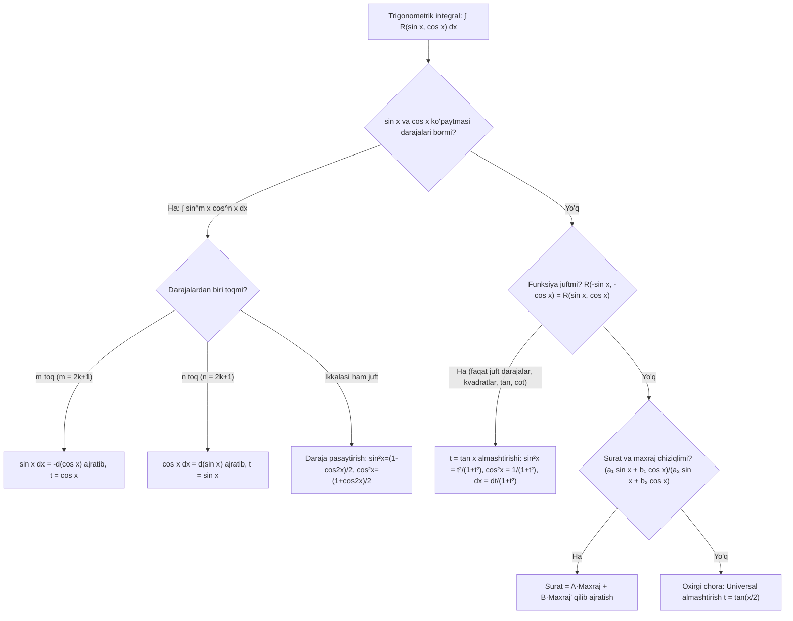

## Kirish: Noaniq integrallashning cho'qqisi

Ko'pgina talabalar integrallash jadvalini va oddiy bo'laklab integrallashni o'zlashtirgach, har qanday integralni elementar funksiyalar orqali hisoblash mumkin degan yanglish fikrga boradilar. Aslida esa matematik analizda hatto ko'rinishidan sodda tuyulgan ko'plab integrallar (masalan, $\int e^{-x^2} dx$, $\int \frac{\sin x}{x} dx$yoki$\int \sqrt{1 - x^4} dx$) elementar funksiyalarda "olinmaydigan" (ifodalanmaydigan) integrallar hisoblanadi.

Xo'sh, qaysi murakkab irratsional va algebraik ifodalar aniq integrallanadi va ularni qanday usullar bilan oson yechish mumkin?

Ushbu professional qo'llanmada biz maxrajida kvadrat uchhad bo'lgan kasrlarda hosila ajratish texnikasini, karrali ildizlar uchun **Ostrogradskiy usulini**, trigonometrik integrallarning to'liq **qaror qabul qilish xaritasini**, buyuk rus matematigi P. L. Chebishevning **binomial differensiallar teoremasini** hamda aniq integrallarni bir necha qatorda yechuvchi **King ko'zgu almashtirishini** chuqur o'rganamiz.

---

## 1. Maxrajda kvadrat uchhad qatnashgan kasrlar va suratda hosila ajratish

Quyidagi ikki turdagi integrallar muhandislik amaliyotida eng ko'p uchraydi:
$$
I_1 = \int \frac{Mx + N}{ax^2 + bx + c} \, dx, \qquad I_2 = \int \frac{Mx + N}{\sqrt{ax^2 + bx + c}} \, dx
$$

### Hosila ajratishning universal 3 bosqichli algoritmi:

1. **Maxraj hosilasini topish:** Maxrajdagi kvadrat uchhadning hosilasi $(ax^2 + bx + c)' = 2ax + b$ ga teng.
2. **Suratda sun'iy hosila hosil qilish:** Suratdagi $Mx + N$ ifodani quyidagicha qayta yozamiz:
$$
Mx + N = \frac{M}{2a}(2ax + b) + \left(N - \frac{Mb}{2a}\right)
$$
3. **Integralni ikkiga ajratish:**
   - Birinchi integral o'zgaruvchini differensial ostiga kiritish orqali darhol jadval integraliga ($\ln|u|$yoki$2\sqrt{u}$) aylanadi:
   $$
   \int \frac{2ax + b}{ax^2 + bx + c} \, dx = \ln|ax^2 + bx + c| + C
   $$
   - Ikkinchi integralda suratda faqat o'zgarmas son qoladi va maxrajda **to'la kvadrat ajratiladi** ($a[(x + \frac{b}{2a})^2 \pm k^2]$). Bu esa $\arctan$(arktangens),$\arcsin$ yoki uzoq logarifmga olib keladi.

---

### 1-Misol: Suratda hosila ajratish
Hisoblang:
$$
I = \int \frac{3x - 1}{x^2 - 4x + 13} \, dx
$$

**Yechish:**
1. Maxraj hosilasi: $(x^2 - 4x + 13)' = 2x - 4$.
2. Suratda $2x - 4$ hosil qilamiz:
$$
3x - 1 = 3\left(x - \frac{1}{3}\right) = \frac{3}{2}(2x - 4 + 4) - 1 = \frac{3}{2}(2x - 4) + 6 - 1 = \frac{3}{2}(2x - 4) + 5
$$
3. Integralni ikkiga ajratamiz:
$$
I = \frac{3}{2} \int \frac{2x - 4}{x^2 - 4x + 13} \, dx + 5 \int \frac{dx}{x^2 - 4x + 13}
$$
4. 1-integral:
$$
I_A = \frac{3}{2} \int \frac{d(x^2 - 4x + 13)}{x^2 - 4x + 13} = \frac{3}{2} \ln(x^2 - 4x + 13)
$$
5. 2-integral: Maxrajda to'la kvadrat ajratamiz: $x^2 - 4x + 13 = (x - 2)^2 + 9 = (x - 2)^2 + 3^2$:
$$
I_B = 5 \int \frac{d(x - 2)}{(x - 2)^2 + 3^2} = \frac{5}{3} \arctan\left(\frac{x - 2}{3}\right)
$$
6. **Umumiy javob:**
$$
I = \frac{3}{2} \ln(x^2 - 4x + 13) + \frac{5}{3} \arctan\left(\frac{x - 2}{3}\right) + C
$$

---

## 2. Maxrajda karrali ildizlar bo'lganda Ostrogradskiy usuli

Agar to'g'ri ratsional kasr $\frac{P(x)}{Q(x)}$ning maxraji karrali ildizlarga (masalan,$(x^2 + 1)^2, (x^2 + 2x + 5)^3$) ega bo'lsa, uni oddiy kasrlarga ajratish juda ko'p qavatli rekurrent formulalarni talab qiladi.

Aynan shu muammoni hal qilish uchun M. V. Ostrogradskiy ajoyib teoremani taklif etgan:

### Ostrogradskiy formulasi:
$$
\int \frac{P(x)}{Q(x)} \, dx = \frac{P_1(x)}{Q_1(x)} + \int \frac{P_2(x)}{Q_2(x)} \, dx
$$
bu yerda:
- $Q_1(x) = \text{EKUB}(Q(x), Q'(x))$— maxraj va uning hosilasining eng katta umumiy bo'luvchisi (u$Q(x)$ ning barcha karrali ko'paytuvchilarini darajasini bittaga kamaytirib o'z ichiga oladi);
- $Q_2(x) = \frac{Q(x)}{Q_1(x)}$ — maxrajning barcha sodda (oddiy) ko'paytuvchilaridan iborat ko'phad;
- $P_1(x)$va$P_2(x)$— darajalari mos ravishda$Q_1(x)$va$Q_2(x)$ dan kamida 1 ga kichik bo'lgan **noma'lum koeffitsiyentli ko'phadlar**.

### Koeffitsiyentlarni topish qoidasi:
Ostrogradskiy formulasining ikkala tomonini differensiallaymiz:
$$
\frac{P(x)}{Q(x)} = \left(\frac{P_1(x)}{Q_1(x)}\right)' + \frac{P_2(x)}{Q_2(x)} = \frac{P_1'(x) Q_1(x) - P_1(x) Q_1'(x)}{Q_1^2(x)} + \frac{P_2(x)}{Q_2(x)}
$$
Ikkala tomonni umumiy maxraj $Q(x)$ ga ko'paytirib, bir xil darajalar oldidagi koeffitsiyentlarni tenglashtirish orqali noma'lumlarni topamiz.

---

### 2-Misol: Ostrogradskiy usuli amalda
Hisoblang:
$$
I = \int \frac{dx}{(x^2 + 1)^2}
$$

**Yechish:**
1. $Q(x) = (x^2 + 1)^2$. U holda $Q'(x) = 2(x^2 + 1) \cdot 2x = 4x(x^2 + 1)$.
2. $\text{EKUB}(Q, Q') = x^2 + 1$.
   Demak: $Q_1(x) = x^2 + 1$va$Q_2(x) = \frac{(x^2 + 1)^2}{x^2 + 1} = x^2 + 1$.
3. $Q_1$va$Q_2$ning darajasi 2 ga teng. Demak,$P_1(x)$va$P_2(x)$1-darajali ko'phadlar bo'ladi:$P_1(x) = Ax + B$, $P_2(x) = Cx + D$.
4. Ostrogradskiy formulasini yozamiz:
$$
\int \frac{dx}{(x^2 + 1)^2} = \frac{Ax + B}{x^2 + 1} + \int \frac{Cx + D}{x^2 + 1} \, dx
$$
5. Ikkala tomonni differensiallaymiz:
$$
\frac{1}{(x^2 + 1)^2} = \frac{A(x^2 + 1) - (Ax + B)(2x)}{(x^2 + 1)^2} + \frac{Cx + D}{x^2 + 1}
$$
6. Umumiy maxraj $(x^2 + 1)^2$ ga ko'paytiramiz:
$$
1 = A(x^2 + 1) - 2Ax^2 - 2Bx + (Cx + D)(x^2 + 1)
$$
$$
1 = -Ax^2 - 2Bx + A + Cx^3 + Dx^2 + Cx + D
$$
$$
1 = C x^3 + (D - A) x^2 + (C - 2B) x + (A + D)
$$
7. Mos koeffitsiyentlarni tenglashtiramiz:
   - $x^3$oldida:$C = 0$-$x^2$oldida:$D - A = 0 \implies D = A$-$x^1$oldida:$C - 2B = 0 \implies 0 - 2B = 0 \implies B = 0$- Ozod had:$A + D = 1 \implies A + A = 1 \implies A = \frac{1}{2}, \quad D = \frac{1}{2}$
8. Topilgan koeffitsiyentlarni qo'yamiz:
$$
I = \frac{\frac{1}{2}x}{x^2 + 1} + \int \frac{\frac{1}{2}}{x^2 + 1} \, dx = \mathbf{\frac{x}{2(x^2 + 1)} + \frac{1}{2} \arctan x + C}
$$
Natija bir zumda va hech qanday murakkab trigonometrik almashtirishlarsiz topildi!

---

## 3. Trigonometrik integrallarning barcha 6 ta klassi bo'yicha qaror qabul qilish xaritasi

Trigonometrik funksiyalarni integrallashda eng katta xato — har doim universal almashtirish ($t = \tan(x/2)$) ga yopishib olishdir. Bu ko'pincha 6-8 darajali dahshatli kasrlarga olib keladi.

Quyidagi **Qaror Qabul Qilish Xaritasi** orqali har bir vaziyat uchun eng optimal usulni tanlang:

### 6 ta klassning qisqacha tavsifi:

| Klass | Integral ko'rinishi | Optimal usul | Formulalar |
|---|---|---|---|
| **1** | $\int \sin^m x \cos^n x \, dx$ ($n$toq) |$t = \sin x$|$\cos x \, dx = dt, \quad \cos^2 x = 1 - t^2$ |
| **2** | $\int \tan^n x \, dx$|$\tan^2 x = \frac{1}{\cos^2 x} - 1$|$\int \tan^{n-2} x (\tan^2 x) dx$ darajani pasaytirish |
| **3** | $\int \sin(ax)\cos(bx) \, dx$| Ko'paytmani yig'indiga aylantirish |$\sin\alpha\cos\beta = \frac{1}{2}[\sin(\alpha-\beta) + \sin(\alpha+\beta)]$ |
| **4** | $\int \frac{dx}{a\sin^2 x + b\cos^2 x}$|$t = \tan x$|$\sin^2 x = \frac{t^2}{1+t^2}, \cos^2 x = \frac{1}{1+t^2}, dx = \frac{dt}{1+t^2}$ |
| **5** | $\int \frac{a_1 \sin x + b_1 \cos x}{a_2 \sin x + b_2 \cos x} dx$|$\text{Surat} = A \cdot M + B \cdot M'$|$A x + B \ln\|a_2 \sin x + b_2 \cos x\| + C$ |
| **6** | $\int \frac{dx}{a + b\cos x + c\sin x}$| Universal$t = \tan(x/2)$|$\sin x = \frac{2t}{1+t^2}, \cos x = \frac{1-t^2}{1+t^2}, dx = \frac{2dt}{1+t^2}$ |

---

## 4. Chebishevning binomial differensiallari va 3 ta integrallanish holati

Quyidagi ko'rinishdagi integral **binomial differensial** deb ataladi:
$$
I = \int x^m (a + b x^n)^p \, dx
$$
bu yerda $a, b$— haqiqiy sonlar,$m, n, p$ esa **ratsional sonlar** (kasrlar)dir.

> [!IMPORTANT]
> **Chebishev Teoremasi (1853-yil):**
> Binomial differensial elementar funksiyalarda ifodalanishi uchun quyidagi **3 ta holatdan faqat bittasi** bajarilishi shart va yetarlidir:
>
> 1. **1-holat: $p$ — butun son ($p \in \mathbb{Z}$).**
>    *Almashtirish:* $x = t^s$, bu yerda $s$—$m$va$n$ kasr darajalar maxrajlarining EKUKi.
>
> 2. **2-holat: $\frac{m + 1}{n}$ — butun son ($\frac{m + 1}{n} \in \mathbb{Z}$).**
>    *Almashtirish:* $a + b x^n = t^s$, bu yerda $s$—$p$ kasr ko'rsatkichining maxraji.
>
> 3. **3-holat: $\frac{m + 1}{n} + p$ — butun son ($\frac{m + 1}{n} + p \in \mathbb{Z}$).**
>    *Almashtirish:* Qavsdan $x^n$chiqariladi va$a x^{-n} + b = t^s$(yoki$a + b x^n = x^n t^s$) almashtirishi kiritiladi, bu yerda $s$—$p$ kasrining maxraji.
>
> Agar bu 3 ta shartdan hech biri bajarilmasa, integral **elementar funksiyalarda olinmaydi**!

---

### 3-Misol: Chebishevning 2-holati
Hisoblang:
$$
I = \int \frac{\sqrt{1 + \sqrt[3]{x}}}{\sqrt[3]{x^2}} \, dx
$$

**Yechish:**
1. Integralni darajalar shaklida yozamiz:
$$
I = \int x^{-2/3} (1 + x^{1/3})^{1/2} \, dx
$$
2. Parametrlarni aniqlaymiz:
   $m = -\frac{2}{3}, \quad n = \frac{1}{3}, \quad p = \frac{1}{2}, \quad a = 1, \quad b = 1$.
3. Chebishev shartlarini tekshiramiz:
   - 1-holat: $p = 1/2 \notin \mathbb{Z}$ (butun emas).
   - 2-holat:
   $$
   \frac{m + 1}{n} = \frac{-2/3 + 1}{1/3} = \frac{1/3}{1/3} = \mathbf{1} \in \mathbb{Z} \quad \text{(Butun son!)}
   $$
   Demak, 2-holat bajarildi! $p = 1/2$ning maxraji$s = 2$.
4. Almashtirish kiritamiz:
$$
1 + x^{1/3} = t^2 \implies x^{1/3} = t^2 - 1 \implies x = (t^2 - 1)^3
$$
$$
dx = 3(t^2 - 1)^2 \cdot 2t \, dt = 6t(t^2 - 1)^2 \, dt
$$
5. Integralga qo'yamiz:
$$
x^{-2/3} = (x^{1/3})^{-2} = (t^2 - 1)^{-2} = \frac{1}{(t^2 - 1)^2}
$$
$$
(1 + x^{1/3})^{1/2} = \sqrt{t^2} = t
$$
Ifodani birlashtiramiz:
$$
I = \int \frac{1}{(t^2 - 1)^2} \cdot t \cdot [6t(t^2 - 1)^2 \, dt] = \int 6t^2 \, dt = 2t^3 + C
$$
6. Dastlabki o'zgaruvchi $x$ ga qaytamiz ($t = \sqrt{1 + x^{1/3}}$):
$$
I = \mathbf{2 \left(\sqrt{1 + \sqrt[3]{x}}\right)^3 + C = 2 (1 + \sqrt[3]{x})^{3/2} + C}
$$
Qanday oson va go'zal yechim!

---

### 4-Misol: Chebishevning 3-holati
Hisoblang:
$$
I = \int \frac{dx}{x^4 \sqrt{1 + x^2}} = \int x^{-4} (1 + x^2)^{-1/2} \, dx
$$

**Yechish:**
1. Parametrlar: $m = -4, \quad n = 2, \quad p = -\frac{1}{2}$.
2. Shartlarni tekshiramiz:
   - 1-holat: $p = -1/2 \notin \mathbb{Z}$- 2-holat:$\frac{m+1}{n} = \frac{-4+1}{2} = -\frac{3}{2} \notin \mathbb{Z}$
   - 3-holat:
   $$
   \frac{m+1}{n} + p = -\frac{3}{2} + \left(-\frac{1}{2}\right) = -\frac{4}{2} = \mathbf{-2} \in \mathbb{Z} \quad \text{(Butun son!)}
   $$
3. 3-holat bajarildi! $p = -1/2$ning maxraji$s = 2$.
   Qavsdan $x^2$ ni chiqaramiz:
   $$
   (1 + x^2)^{-1/2} = (x^2(x^{-2} + 1))^{-1/2} = x^{-1}(x^{-2} + 1)^{-1/2}
   $$
   Shunda integral quyidagi ko'rinishga keladi:
   $$
   I = \int x^{-4} \cdot x^{-1} (x^{-2} + 1)^{-1/2} \, dx = \int x^{-5} (x^{-2} + 1)^{-1/2} \, dx
   $$
4. Almashtirish: $x^{-2} + 1 = t^2 \implies -2x^{-3} dx = 2t dt \implies x^{-3} dx = -t dt$.
   Shuningdek $x^{-2} = t^2 - 1$.
   Ifodalaymiz: $x^{-5} dx = x^{-2} \cdot (x^{-3} dx) = (t^2 - 1)(-t dt)$.
5. Integralga qo'yamiz:
$$
I = \int (t^2 - 1)(-t \, dt) \cdot \frac{1}{t} = -\int (t^2 - 1) \, dt = \int (1 - t^2) \, dt = t - \frac{t^3}{3} + C
$$
6. $t = \sqrt{x^{-2} + 1} = \frac{\sqrt{1 + x^2}}{x}$ ekanidan:
$$
I = \frac{\sqrt{1 + x^2}}{x} - \frac{(1 + x^2)\sqrt{1 + x^2}}{3x^3} + C = \mathbf{\frac{(2x^2 - 1)\sqrt{1 + x^2}}{3x^3} + C}
$$

---

## 5. Aniq integrallarni hisoblashning effektiv usullari: King ko'zgu almashtirishi

Aniq integrallarni hisoblashda Nyuton-Leybnits formulasiga boshlang'ich funksiyani qo'yish ba'zan imkonsizdek tuyuladi. Bunday vaqtda xalqaro olimpiadalarda keng qo'llaniladigan **King xossasi (Ko'zgu formulasi)** yordamga keladi.

### King Teoremasi:
Ixtiyoriy $[a, b]$kesmada uzluksiz$f(x)$ funksiya uchun:
$$
\int_a^b f(x) \, dx = \int_a^b f(a + b - x) \, dx
$$

**Isboti:** $x = a + b - t$almashtirishini bajaramiz.$dx = -dt$. Chegaralar: $x = a \implies t = b$; $x = b \implies t = a$.
$$
\int_a^b f(x) \, dx = \int_b^a f(a + b - t)(-dt) = \int_a^b f(a + b - t) \, dt = \int_a^b f(a + b - x) \, dx
$$

---

### Mashhur Olimpiada Masalasi:
Hisoblang:
$$
I = \int_0^{\pi/2} \frac{\sqrt{\sin x}}{\sqrt{\sin x} + \sqrt{\cos x}} \, dx
$$

**Yechish:**
1. Bu yerda $a = 0, b = \pi/2 \implies a + b - x = \frac{\pi}{2} - x$.
2. Keltirish formulalariga ko'ra:
   $\sin(\pi/2 - x) = \cos x$va$\cos(\pi/2 - x) = \sin x$.
3. King formulasiga ko'ra berilgan integral quyidagiga teng:
$$
I = \int_0^{\pi/2} \frac{\sqrt{\cos x}}{\sqrt{\cos x} + \sqrt{\sin x}} \, dx
$$
4. Endi ikkala tenglikni hadma-had qo'shamiz ($I + I = 2I$):
$$
2I = \int_0^{\pi/2} \frac{\sqrt{\sin x}}{\sqrt{\sin x} + \sqrt{\cos x}} \, dx + \int_0^{\pi/2} \frac{\sqrt{\cos x}}{\sqrt{\sin x} + \sqrt{\cos x}} \, dx
$$
$$
2I = \int_0^{\pi/2} \frac{\sqrt{\sin x} + \sqrt{\cos x}}{\sqrt{\sin x} + \sqrt{\cos x}} \, dx = \int_0^{\pi/2} 1 \, dx = [x]_0^{\pi/2} = \frac{\pi}{2}
$$
5. Natija:
$$
2I = \frac{\pi}{2} \implies I = \mathbf{\frac{\pi}{4}}
$$
Boshlang'ich funksiyasi o'ta og'ir bo'lgan integral bir necha soniyada yechildi!

---

## 6. To'liq yechilgan misollar va mustaqil mashqlar

### Namunaviy Misol: Chiziqli trigonometrik kasr
Hisoblang:
$$
I = \int \frac{2\sin x + 3\cos x}{3\sin x + 4\cos x} \, dx
$$

**Yechish:**
Suratni maxraj va maxraj hosilasi orqali ifodalaymiz:
$$
2\sin x + 3\cos x = A(3\sin x + 4\cos x) + B(3\sin x + 4\cos x)'
$$
$$
2\sin x + 3\cos x = A(3\sin x + 4\cos x) + B(3\cos x - 4\sin x)
$$
$$
2\sin x + 3\cos x = (3A - 4B)\sin x + (4A + 3B)\cos x
$$
Tenglamalar sistemasini tuzamiz:
$$
\begin{cases}
3A - 4B = 2 \\
4A + 3B = 3
\end{cases}
$$
1-tenglamani 3 ga, 2-tenglamani 4 ga ko'paytirib qo'shamiz:
$9A - 12B + 16A + 12B = 6 + 12 \implies 25A = 18 \implies A = \frac{18}{25}$.
U holda $4B = 3A - 2 = 3(18/25) - 2 = 54/25 - 50/25 = 4/25 \implies B = \frac{1}{25}$.

Integralni yozamiz:
$$
I = \int \left[ \frac{18}{25} + \frac{1}{25} \cdot \frac{(3\sin x + 4\cos x)'}{3\sin x + 4\cos x} \right] dx
$$
$$
= \mathbf{\frac{18}{25}x + \frac{1}{25}\ln|3\sin x + 4\cos x| + C}
$$

---

### Mustaqil yechish uchun mashqlar

1. **Mashq (Kvadrat uchhad):**
$$
\int \frac{2x + 5}{x^2 + 2x + 5} \, dx
$$
*Javob:* $\ln(x^2 + 2x + 5) + \frac{3}{2} \arctan\left(\frac{x+1}{2}\right) + C$

2. **Mashq (Ostrogradskiy usuli):**
$$
\int \frac{dx}{(x^2 + 4)^2}
$$
*Javob:* $\frac{x}{8(x^2 + 4)} + \frac{1}{16} \arctan\left(\frac{x}{2}\right) + C$

3. **Mashq (Chebishev integrali):**
$$
\int \frac{dx}{\sqrt{x} (1 + \sqrt[3]{x})}
$$
*Ko'rsatma:* $x^{-1/2}(1 + x^{1/3})^{-1} dx$. $p = -1 \in \mathbb{Z}$(1-holat).$x = t^6$ almashtirishini bajaring.
*Javob:* $6\sqrt[6]{x} - 6\arctan(\sqrt[6]{x}) + C$

4. **Mashq (King xossasi):**
$$
\int_0^\pi \frac{x \sin x}{1 + \cos^2 x} \, dx
$$
*Ko'rsatma:* $x = \pi - t$ qo'llang.
*Javob:* $\frac{\pi^2}{4}$
