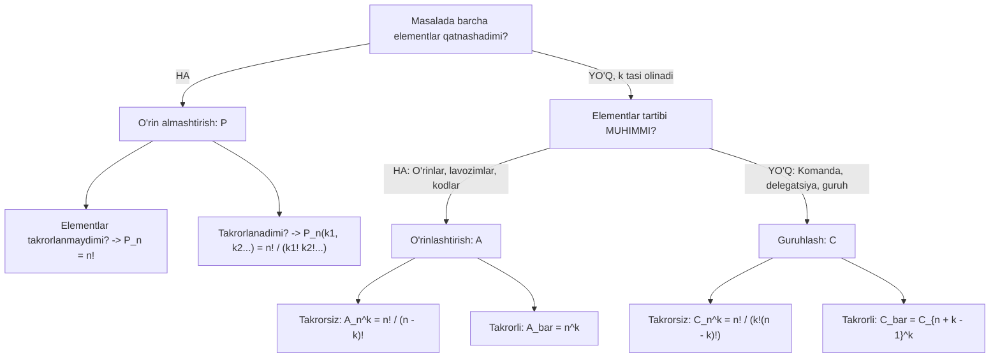

## 📌 Kirish va Geometrik/Fizik Mohiyat

Kombinatorika — bu chekli yoki sanoqli to'plamlar elementlaridan berilgan qoidalar asosida turli kombinatsiyalar, konfiguratsiyalar tuzish va ularning umumiy sonini **bittalab sanab chiqmasdan**, analitik formulalar yordamida tezkor hisoblash bilan shug'ullanadigan matematika sohasidir.

Agar insoniyat kombinatorika qoidalarini bilmaganida, hatto 10 ta elementdan tuzilgan kombinatsiyalarni sanash uchun ham yillab vaqt sarflagan bo'lardi (masalan, $10! = 3\,628\,800$ ta holat!).

Zamonaviy fan va raqamli texnologiyalarda kombinatorika hal qiluvchi o'rin tutadi:
1. **Ehtimollar nazariyasi:** Klassik ehtimollik $P(A) = \frac{m}{n}$ formulasidagi jami elementar hodisalar soni $n$ va qulay hodisalar soni $m$ bevosita kombinatorika formulalari ($C_n^k, A_n^k, P_n$) orqali topiladi.
2. **Kriptografiya va Axborot xavfsizligi:** Parollarning mustahkamligi, xakerlik hujumlariga (Brute-force) chidamliligi, shifrlash kalitlari soni (masalan, AES-256 yoki RSA) kombinatorik variantlar hajmiga asoslanadi.
3. **Bioinformatika va Genetika:** DNK va RNK molekulalaridagi 4 ta asosiy nukleotidlar (A, T, G, C) dan oqsil kodlovchi tripletlar (kodonlar) sonini aniqlash ($4^3 = 64$).
4. **Dasturlash va Ma'lumotlar tuzilmasi:** Graf algoritmlari, qidiruv tizimlari va marshrutlash masalalari.

Kombinatorik masalalarni yechishda talaba o'ziga har doim **ikkita fundamental savol**ni berishi shart:
1. **Tartib muhimmi?** (Elementlarning joylashish o'rni natijaga ta'sir qiladimi?)
2. **Elementlar takrorlanishi mumkinmi?**

---

## 📐 Asosiy Nazariya, Qoidalar va Teoremalar

### 1. Kombinatorikaning asosiy qoidalari

#### Qo'shish qoidasi (Mantiqiy "YOKI" / "OR"):
Agar $A$ obyektni $m$ xil usul bilan, $B$ obyektni esa $n$ xil usul bilan tanlash mumkin bo'lsa va $A$ hamda $B$ tanlovlari bir vaqtda bajarilishi mumkin bo'lmasa (kesishmaydigan to'plamlar), u holda "$A$ yoki $B$" obyektini tanlash:
$$
N = m + n
$$
xil usul bilan amalga oshiriladi.

#### Ko'paytirish qoidasi (Mantiqiy "VA" / "AND"):
Agar birinchi harakatni $m$ xil usul bilan, shundan so'ng ikkinchi harakatni $n$ xil usul bilan bajarish mumkin bo'lsa, bu ikki harakatni ketma-ket bajarish ("birinchisi VA ikkinchisi"):
$$
N = m \cdot n
$$
xil usulda amalga oshiriladi.

---

### 2. O'rin almashtirishlar (Permutations — $P$)

To'plamdagi **barcha $n$ ta element** qatnashadi va faqat ularning **tartibi (ketma-ketligi)** o'zgaradi.

#### 1) Takrorsiz o'rin almashtirish:
$n$ ta turlicha elementni bir qatorga terish usullari soni:
$$
P_n = n! = 1 \cdot 2 \cdot 3 \dots n
$$
*(Maxsus kelishuv: $0! = 1$).*

#### 2) Takrorli o'rin almashtirish:
Agar $n$ ta elementdan $k_1$ tasi birinchi turdagi, $k_2$ tasi ikkinchi turdagi, ..., $k_m$ tasi $m$ - turdagi bir xil (bir-biridan farq qilmaydigan) elementlar bo'lsa ($k_1 + k_2 + \dots + k_m = n$), ulardan tuzilgan barcha o'rin almashtirishlar soni:
$$
P_n(k_1, k_2, \dots, k_m) = \frac{n!}{k_1! \cdot k_2! \dots k_m!}
$$

#### 3) Doiraviy o'rin almashtirish:
$n$ nafar odamni dumaloq stol atrofida o'tqazish usullari soni (aylana bo'ylab siljishlar bir xil deb hisoblanadi):
$$
P_{\text{doira}} = (n - 1)!
$$

---

### 3. O'rinlashtirishlar (Arrangements / Variations — $A$)

$n$ ta elementdan iborat to'plamdan $k$ tasini tanlab olamiz. Bunda **ham tanlangan elementlar tarkibi, ham ularning joylashish TARTIBI muhim!**

#### 1) Takrorsiz o'rinlashtirish ($k \le n$):
$$
A_n^k = \frac{n!}{(n - k)!} = n(n - 1)(n - 2)\dots(n - k + 1)
$$
*(Bunda $k$ ta ko'paytuvchi ishtirok etadi).*

#### 2) Takrorli o'rinlashtirish:
$n$ xil elementdan har bir pozitsiyada takrorlash imkoniyati bilan $k$ tasi tanlansa:
$$
\overline{A}_n^k = n^k
$$
*(Masalan: $k$ xonali PIN-kodlar, belgilar takrorlanishi mumkin).*

---

### 4. Guruhlashlar / Kombinatsiyalar (Combinations — $C$)

$n$ ta elementdan $k$ tasini tanlab olamiz. Bunda **tartib MUHIM EMAS!** Faqat qaysi elementlar tanlangani (tarkib) ahamiyatga ega.

#### 1) Takrorsiz guruhlash:
$$
C_n^k = \binom{n}{k} = \frac{n!}{k!(n - k)!} = \frac{A_n^k}{P_k}
$$

**Kombinatsiyalarning asosiy xossalari:**
1. **Simmetriklik xossasi:**
   $$
   C_n^k = C_n^{n - k}
   $$
   *(Masalan: $C_{100}^{98} = C_{100}^2 = \frac{100 \cdot 99}{2} = 4950$).*
2. **Chekka qiymatlar:**
   $$
   C_n^0 = C_n^n = 1, \quad C_n^1 = n
   $$
3. **Paskal qoidasi (Paskal uchburchagi qonuniyati):**
   $$
   C_n^k + C_n^{k + 1} = C_{n + 1}^{k + 1}
   $$
4. **Barcha qism-to'plamlar soni:**
   $$
   \sum_{k=0}^n C_n^k = C_n^0 + C_n^1 + C_n^2 + \dots + C_n^n = 2^n
   $$

#### 2) Takrorli guruhlash ("Tayoqchalar va yulduzchalar" — Stars and Bars usuli):
$n$ turdagi buyumlardan takrorlanishiga ruxsat berilgan holda $k$ tasini tanlash (tartib hisobga olinmaydi):
$$
\overline{C}_n^k = C_{n + k - 1}^k = \frac{(n + k - 1)!}{k! (n - 1)!}
$$

---

### 5. Nyuton binomi formulasi

Ixtiyoriy natural $n$ daraja uchun ikkihad yoyilmasi:
$$
(a + b)^n = \sum_{k=0}^n C_n^k a^{n - k} b^k = C_n^0 a^n + C_n^1 a^{n-1}b + C_n^2 a^{n-2}b^2 + \dots + C_n^n b^n
$$
Yoyilmaning umumiy $(k + 1)$ - hadi:
$$
T_{k + 1} = C_n^k a^{n - k} b^k
$$

---

### 6. Universal tanlash algoritmi (Qaysi formulani tanlash kerak?)



---

## 📝 Qadamma-qadam Yechilgan Universitet Misollari

### 1-misol: Avtomobil raqamlari va PIN-kodlar kombinatorikasi
**Shart:** 
1) Bankomat PIN-kodi 4 ta raqamdan iborat. Agar raqamlar takrorlanishi mumkin bo'lsa, jami nechta turli PIN-kod yaratish mumkin?
2) Agar PIN-kodda barcha raqamlar turlicha (takrorlanmas) bo'lishi talab qilinsa-chi?
3) Avtomobil davlat raqami 3 ta harf va 3 ta raqamdan iborat (masalan, `01 A 777 AA`). Agar alifboning 24 ta harfi va 10 ta raqamdan ($0-9$) foydalanilsa, harflar va raqamlar takrorlanishi mumkin bo'lganda nechta avtomobil raqami yasash mumkin?

**Yechish:**
1-qadam: Takrorli PIN-kod:
Har bir pozitsiyada 10 ta raqamdan ($0, 1, \dots, 9$) biri turishi mumkin. Pozitsiyalar soni $k = 4$, tanlovlar soni $n = 10$.  
Tartib muhim (chunki $1234$ bilan $4321$ boshqa PIN-kodlar).  
Takrorli o'rinlashtirish formulasiga ko'ra:
$$
\overline{A}_{10}^4 = 10^4 = 10\,000\text{ ta}
$$
*(Ko'paytirish qoidasi: $10 \cdot 10 \cdot 10 \cdot 10 = 10\,000$).*

2-qadam: Takrorsiz PIN-kod:
Raqamlar takrorlanmasligi kerak.  
Takrorsiz o'rinlashtirish:
$$
A_{10}^4 = \frac{10!}{(10 - 4)!} = 10 \cdot 9 \cdot 8 \cdot 7 = 5\,040\text{ ta}
$$

3-qadam: Avtomobil raqamlari:
- 3 ta raqamni tanlash: $\overline{A}_{10}^3 = 10^3 = 1000$ xil.
- 3 ta harfni tanlash: $\overline{A}_{24}^3 = 24^3 = 13\,824$ xil.  
Ko'paytirish qoidasiga ko'ra:
$$
N = 1000 \cdot 13\,824 = 13\,824\,000\text{ ta}
$$
Demak, bitta hudud kodi uchun qariyb 13.8 millionta avtomobil raqami hosil qilish mumkin.

**Javob:** 1) $10\,000$; 2) $5\,040$; 3) $13\,824\,000$.

---

### 2-misol: Takrorli o'rin almashtirish va anagrammalar
**Shart:** 
1) "MATEMATIKA" so'zidagi barcha harflardan foydalanib nechta turli xil so'z (anagramma) yasash mumkin?
2) Hosil qilingan anagrammalarning nechtasida ikkita "M" harfi yonma-yon turadi?

**Yechish:**
1-qadam: Jami anagrammalar soni:
"MATEMATIKA" so'zida jami $n = 10$ ta harf bor.  
Harflar tarkibini sanaymiz:
- 'M' — 2 ta;
- 'A' — 3 ta;
- 'T' — 2 ta;
- 'E' — 1 ta;
- 'I' — 1 ta;
- 'K' — 1 ta.  
Tekshirish: $2 + 3 + 2 + 1 + 1 + 1 = 10$.  
Takrorli o'rin almashtirish formulasi:
$$
P_{10}(2, 3, 2, 1, 1, 1) = \frac{10!}{2! \cdot 3! \cdot 2! \cdot 1! \cdot 1! \cdot 1!}
$$
Hisoblaymiz:
$$
10! = 3\,628\,800
$$
$$
2! \cdot 3! \cdot 2! = 2 \cdot 6 \cdot 2 = 24
$$
$$
P = \frac{3\,628\,800}{24} = 151\,200\text{ ta}
$$

2-qadam: Ikkita "M" harfi yonma-yon turgan holatlar soni:
**"Bog'langan blok" (Super-element) usulini qo'llaymiz:**  
Ikkala 'M' harfini bitta ajralmas blok deb tasavvur qilamiz: `[MM]`.  
Endi to'plamimizda quyidagi elementlar qoladi:
`[MM]`, 'A', 'T', 'E', 'A', 'T', 'I', 'K', 'A'.  
Jami obyektlar soni: $n' = 1 + 3 + 2 + 1 + 1 + 1 = 9$ ta.  
Ushbu 9 ta obyekt bo'yicha takrorli o'rin almashtirish:
- `[MM]` — 1 ta blok;
- 'A' — 3 ta;
- 'T' — 2 ta;
- 'E', 'I', 'K' — 1 tadan.
$$
P' = \frac{9!}{1! \cdot 3! \cdot 2! \cdot 1! \cdot 1! \cdot 1!} = \frac{362\,880}{6 \cdot 2} = \frac{362\,880}{12} = 30\,240\text{ ta}
$$
*(Blok ichidagi ikkita 'M' harfi bir xil bo'lgani uchun ularning o'zaro almashinuvini alohida ko'paytirish shart emas).*

**Javob:** 1) $151\,200$ ta; 2) $30\,240$ ta.

---

### 3-misol: Delegatsiya tanlash va "hech bo'lmaganda bitta" masalasi
**Shart:** Tashkilotda 12 nafar erkak va 8 nafar ayol xodim ishlaydi. 5 kishidan iborat delegatsiya tuzilishi kerak.
1) Jami nechta turli usulda delegatsiya tuzish mumkin?
2) Delegatsiyada aniq 3 nafar erkak va 2 nafar ayol bo'lishi usullari soni nechta?
3) Delegatsiyada **hech bo'lmaganda bitta ayol kishi** bo'lishi usullari soni nechta?

**Yechish:**
1-qadam: Jami usullar:
Jami xodimlar: $12 + 8 = 20$ nafar. Delegatsiyada tartib muhim emas (oddiy guruh).  
Demak, takrorsiz guruhlash ($C$):
$$
C_{20}^5 = \frac{20!}{5! \cdot 15!} = \frac{20 \cdot 19 \cdot 18 \cdot 17 \cdot 16}{5 \cdot 4 \cdot 3 \cdot 2 \cdot 1} = \frac{1\,860\,480}{120} = 15\,504\text{ ta}
$$

2-qadam: 3 nafar erkak VA 2 nafar ayol:
- 12 nafar erkakdan 3 tasini tanlash: $C_{12}^3$
$$
C_{12}^3 = \frac{12 \cdot 11 \cdot 10}{3 \cdot 2 \cdot 1} = 220\text{ xil}
$$
- 8 nafar ayoldan 2 tasini tanlash: $C_8^2$
$$
C_8^2 = \frac{8 \cdot 7}{2 \cdot 1} = 28\text{ xil}
$$
Ko'paytirish qoidasiga ko'ra:
$$
N = C_{12}^3 \cdot C_8^2 = 220 \cdot 28 = 6\,160\text{ ta}
$$

3-qadam: Hech bo'lmaganda bitta ayol kishi:
**Qarama-qarshi hodisa usulini qo'llaymiz:**  
To'g'ridan-to'g'ri (1 ta ayol, 2 ta ayol, ..., 5 ta ayol) hisoblab chiqish uzoq vaqt oladi.  
Osonroq yo'li: umumiy barcha delegatsiyalar sonidan **faqat erkaklardan iborat** delegatsiyalar sonini ayirib tashlaymiz!
- Faqat erkaklardan iborat (0 ta ayol) delegatsiyalar soni:
$$
N_{\text{faqat erkak}} = C_{12}^5 = \frac{12 \cdot 11 \cdot 10 \cdot 9 \cdot 8}{5 \cdot 4 \cdot 3 \cdot 2 \cdot 1} = 792\text{ ta}
$$
Hech bo'lmaganda bitta ayol bo'lgan guruhlar soni:
$$
N_{\text{kamida 1 ayol}} = C_{20}^5 - C_{12}^5 = 15\,504 - 792 = 14\,712\text{ ta}
$$

**Javob:** 1) $15\,504$; 2) $6\,160$; 3) $14\,712$.

---

### 4-misol: Takrorli guruhlash ("Stars and Bars" — Olmalarni taqsimlash)
**Shart:** 10 ta bir xil (farqlanmaydigan) olmani 4 nafar bolaga necha xil usulda bo'lib berish mumkin, agar:
1) Har bir bola istalgancha (jumladan 0 ta) olma olishi mumkin bo'lsa;
2) Har bir bolaga kamida 1 tadan olma berilishi shart bo'lsa?

**Yechish:**
1-qadam: 1-band (0 yoki undan ortiq olma):
Bu klassik takrorli guruhlash masalasidir: $k = 10$ ta bir xil buyumni $n = 4$ ta qutiga taqsimlash.  
"Tayoqchalar va yulduzchalar" usuli: 10 ta olmani ajratish uchun bolalar orasiga $n - 1 = 4 - 1 = 3$ ta to'siq (tayoqcha) qo'yish kerak.  
Jami pozitsiyalar: $10\text{ ta olma} + 3\text{ ta to'siq} = 13$ ta joy.  
Ushbu 13 ta joydan 3 tasini to'siqlar uchun tanlaymiz:
$$
\overline{C}_n^k = C_{n + k - 1}^k = C_{4 + 10 - 1}^{10} = C_{13}^{10} = C_{13}^3
$$
Hisoblaymiz:
$$
C_{13}^3 = \frac{13 \cdot 12 \cdot 11}{3 \cdot 2 \cdot 1} = \frac{1716}{6} = 286\text{ ta}
$$

2-qadam: 2-band (har bir bolaga kamida 1 tadan):
Har bir bolaga avvaldan bittadan olma tarqatib chiqamiz: $4 \cdot 1 = 4$ ta olma ketdi.  
Qolgan $10 - 4 = 6$ ta olmani 4 nafar bolaga yana ixtiyoriy taqsimlaymiz:
Endi $k' = 6, n = 4$:
$$
\overline{C}_4^6 = C_{4 + 6 - 1}^6 = C_9^6 = C_9^3 = \frac{9 \cdot 8 \cdot 7}{3 \cdot 2 \cdot 1} = \frac{504}{6} = 84\text{ ta}
$$
*(Muqobil formula: $k$ ta obyektni $n$ ta qutiga bo'sh qoldirmasdan taqsimlash usullari soni: $C_{k - 1}^{n - 1} = C_{10 - 1}^{4 - 1} = C_9^3 = 84$).*

**Javob:** 1) 286 xil; 2) 84 xil.

---

## ⚠️ Talabalar Eng Ko'p Yo'l Qo'yadigan Xatolar va Tuzoqlar

1. **O'rinlashtirish ($A_n^k$) va Guruhlash ($C_n^k$) ni adashtirish:**
   Eng keng tarqalgan xato — tartib muhimmi yoki yo'qligini aniqlamasdan formula tanlash.
   - Masalan: "10 kishidan 3 kishilik jamoa tuzish" $\to$ tartib muhim emas $\implies C_{10}^3$.
   - "10 kishidan prezident, vitse-prezident va kotib saylash" $\to$ lavozimlar (tartib) muhim $\implies A_{10}^3$.

2. **Takrorli harflarda oddiy faktorialni ($n!$) ishlatish:**
   "KASSA" so'zida 5 ta harf bor deb $5! = 120$ deb yozishadi. Vaholanki, 'S' harfi 2 marta qatnashgani uchun har bir so'z 2 martadan takrorlanadi: to'g'ri javob $\frac{5!}{2!} = 60$.

3. **"Hech bo'lmaganda bitta" masalasida to'g'ridan-to'g'ri sanashda adashish:**
   Talabalar birinchi ayolni tanlab ($C_8^1$), so'ng qolgan 4 kishini qolgan 19 kishidan tanlaymiz deb $C_8^1 \cdot C_{19}^4$ deb hisoblashadi. Bu **ikki marta hisoblash (Double counting)** xatosini keltirib chiqaradi va natija sun'iy kattalashib ketadi! Barcha bunday masalalarda faqat **qarama-qarshi hodisa**: $N_{\text{jami}} - N_{\text{bitta ham emas}}$ usuli qo'llanilishi shart.

4. **Takrorli guruhlashda $n$ va $k$ ni adashtirib qo'yish:**
   $\overline{C}_n^k = C_{n + k - 1}^k$ formulasida $n$ — qutilar (turlar) soni, $k$ — taqsimlanayotgan buyumlar soni. Agar ularning o'rni almashib qolsa, butunlay xato natija chiqadi.

---

## 🎯 Mustaqil Yechish Uchun Amaliy Mashqlar va Yechimlar

### 1-mashq
10 ta kitobni javonga necha xil usulda taxlash mumkin?

<details>
<summary>To'liq yechimi va javobi</summary>

**Yechish:**
Barcha 10 ta kitob javonga teriladi, demak bu takrorsiz o'rin almashtirish:
$$
P_{10} = 10! = 1 \cdot 2 \cdot 3 \cdot 4 \cdot 5 \cdot 6 \cdot 7 \cdot 8 \cdot 9 \cdot 10 = 3\,628\,800\text{ xil}
$$

**Javob:** $3\,628\,800$.
</details>

---

### 2-mashq
Shaxmat musobaqasida 12 nafar shaxmatchi ishtirok etmoqda. Agar har bir shaxmatchi qolgan barcha ishtirokchilar bilan bittadan partiya o'ynasa, jami nechta partiya o'ynaladi?

<details>
<summary>To'liq yechimi va javobi</summary>

**Yechish:**
Bitta partiya o'ynalishi uchun 12 kishidan ixtiyoriy 2 kishini tanlash kerak.  
Tartib muhim emas (Ali va Vali o'ynashi bilan Vali va Ali o'ynashi bitta o'yin).  
Demak, takrorsiz guruhlash:
$$
C_{12}^2 = \frac{12 \cdot 11}{2 \cdot 1} = 66\text{ ta partiya}
$$

**Javob:** 66 ta partiya.
</details>

---

### 3-mashq
Guruhda 15 nafar talaba bor. Ulardan bitta sardor (starosta) va uning yordamchisini necha xil usulda saylash mumkin?

<details>
<summary>To'liq yechimi va javobi</summary>

**Yechish:**
Bu yerda 15 kishidan 2 kishi tanlanadi, ammo ularning rollari (lavozimlari) turlicha, demak **tartib muhim!**  
O'rinlashtirish formulasi:
$$
A_{15}^2 = \frac{15!}{(15 - 2)!} = 15 \cdot 14 = 210\text{ xil}
$$
*(Ko'paytirish qoidasi: sardorlikka 15 ta nomzod, shundan so'ng yordamchilikka qolgan 14 kishidan biri: $15 \cdot 14 = 210$).*

**Javob:** 210 xil.
</details>

---

## 💡 Imtihon Layfhaklari va Tezkor Maslahatlar

1. **Simmetriklik xossasidan foydalanib hisoblashni 10 barobar qisqartirish:**
   Imtihonda $C_{20}^{18}$ ni hisoblash so'ralsa, 18 ta ko'paytuvchini yozib o'tirmang!
   $$
   C_{20}^{18} = C_{20}^{20 - 18} = C_{20}^2 = \frac{20 \cdot 19}{2} = 190
   $$
   Ushbu usul hisoblash vaqtini bir necha soniyaga tushiradi.

2. **Ko'paytirish qoidasi — formulalarni eslashning eng oddiy yo'li:**
   Agar formulalarni chalkashtirib yuborsangiz, har doim pozitsiyalar (katakchalar) chizing.  
   Masalan, $A_5^3$ uchun uchta katak chizing: birinchi katakka 5 ta, ikkinchisiga 4 ta, uchinchisiga 3 ta variant $\implies 5 \cdot 4 \cdot 3 = 60$. Agar tartib muhim bo'lmasa, uni tanlangan sonlar faktorialiga ($3! = 6$) bo'ling: $\frac{60}{6} = 10 = C_5^3$.

3. **Paskal uchburchagi shpargalkasi:**
   Kichik $n$ lar uchun ($n \le 6$) kombinatsiyalarni formula orqali hisoblamasdan, qoralama chetiga Paskal uchburchagini chizib olish tezroq va xatosizdir:
   ```
   n=0:       1
   n=1:      1 1
   n=2:     1 2 1
   n=3:    1 3 3 1
   n=4:   1 4 6 4 1
   n=5: 1 5 10 10 5 1
   ```
