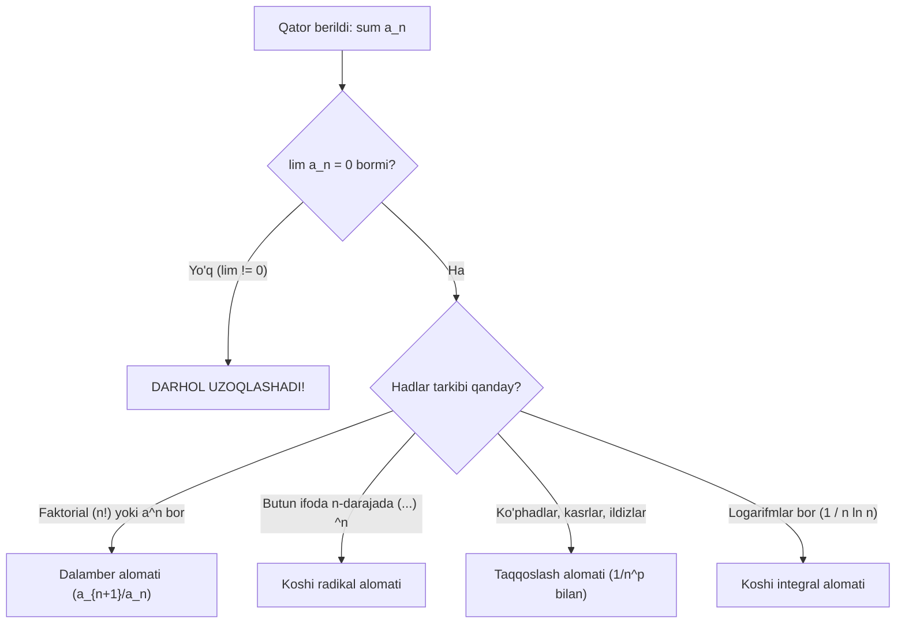

## Kirish: Qatorni qanday qilib oson tekshirish mumkin?

Har qanday cheksiz qatorning qismiy yig'indisi $S_n$ uchun chiroyli ixcham formula topish juda kamdan-kam uchraydi. Shuning uchun matematik analizda qator yig'indisini hisoblab o'tirmasdan, uning **yaqinlashishi yoki uzoqlashishini** aniqlash imkonini beruvchi kuchli **yaqinlashish alomatlari** yaratilgan.

Ushbu darsda barcha hadlari musbat bo'lgan ($a_n > 0$) qatorlarni tekshirishning eng asosiy 4 ta universal qurolini o'rganamiz.

---

## 1. O'lchov standarti: Umumlashgan garmonik qator (Dirixle)

Barcha taqqoslash alomatlarida etalon (o'lchov birligi) sifatida quyidagi qator ishlatiladi:

$$
\sum_{n=1}^\infty \frac{1}{n^p} = \frac{1}{1^p} + \frac{1}{2^p} + \frac{1}{3^p} + \dots + \frac{1}{n^p} + \dots
$$

> **Oltin Qoida:**
> - Agar $p > 1$ bo'lsa $\implies$ qator **YAQINLASHADI** (masalan, $\sum \frac{1}{n^2}$, $\sum \frac{1}{n^3}$, $\sum \frac{1}{n^{1.5}}$);
> - Agar $p \le 1$ bo'lsa $\implies$ qator **UZOQLASHADI** (masalan, $p=1$ da garmonik qator $\sum \frac{1}{n}$, $p=\frac{1}{2}$ da $\sum \frac{1}{\sqrt{n}}$).

---

## 2. 1-qurol: Taqqoslash alomatlari

### A. Chekli limit ko'rinishidagi taqqoslash alomati (Eng qulayi!)
Ikkita musbat hadli $\sum a_n$ va $\sum b_n$ qatorlar uchun umumiy hadlar nisbatining limitini hisoblaymiz:

$$
\lim_{n \to \infty} \frac{a_n}{b_n} = k \quad (0 < k < \infty)
$$

Agar $k$ chekli va noldan farqli son chiqsa, ikkala qator **bir vaqtda yaqinlashadi yoki bir vaqtda uzoqlashadi**!

### Amaliy layfhak ($b_n$ ni qanday tanlash kerak?):
Agar $a_n$ algebraik kasr yoki ildizli ifoda bo'lsa, surat va maxrajdagi eng katta darajalarni qoldirib, qolgan barcha kichik hadlarni tashlab yuboramiz. Hosil bo'lgan $\frac{1}{n^p}$ qatori bizning $b_n$ etalonimiz bo'ladi!

---

## 3. 2-qurol: Dalamber alomati (Nisbat alomati)

Agar umumiy hadda **faktoriallar ($n!$)** yoki **ko'rsatkichli darajalar ($a^n$)** qatnashgan bo'lsa, Dalamber alomati eng yaxshi tanlovdir:

$$
D = \lim_{n \to \infty} \frac{a_{n+1}}{a_n}
$$

- Agar $D < 1$ bo'lsa $\implies$ qator **YAQINLASHADI**;
- Agar $D > 1$ bo'lsa $\implies$ qator **UZOQLASHADI**;
- Agar $D = 1$ bo'lsa $\implies$ **noaniq holat** (Dalamber javob bera olmaydi! Boshqa alomat, masalan taqqoslash yoki integral alomat ishlatiladi).

> 💡 **Faktoriallar bilan ishlash siri:**
> $\frac{(n+1)!}{n!} = \frac{n! \cdot (n+1)}{n!} = n+1$.

---

## 4. 3-qurol: Koshi radikal (ildiz) alomati

Agar butun umumiy had $n$-darajaga ko'tarilgan bo'lsa ($a_n = [f(n)]^n$):

$$
C = \lim_{n \to \infty} \sqrt[n]{a_n}
$$

- Agar $C < 1$ bo'lsa $\implies$ qator **YAQINLASHADI**;
- Agar $C > 1$ bo'lsa $\implies$ qator **UZOQLASHADI**;
- Agar $C = 1$ bo'lsa $\implies$ **noaniq holat**.

---

## 5. 4-qurol: Koshi integral alomati

Agar $a_n = f(n)$ bo'lib, $f(x)$ funksiya $[1; +\infty)$ oraliqda uzluksiz, musbat va monoton kamayuvchi bo'lsa:

$$
\sum_{n=1}^\infty a_n \quad \text{va} \quad \int_1^\infty f(x) \, dx
$$
bir vaqtda yaqinlashadi yoki bir vaqtda uzoqlashadi!
*(Bu alomat ayniqsa logarifm qatnashgan $\sum \frac{1}{n \ln n}$ ko'rinishidagi qatorlarni tekshirishda tengsizdir).*

---

## 6. "Qaysi alomatni tanlash kerak?" (Xarita)

---

## 7. Amaliy misollar va batafsil yechimlar

### 1-misol: Dalamber alomati (Faktorialli qator)
Qatorning yaqinlashishini tekshiring:
$$
\sum_{n=1}^\infty \frac{2^n}{n!}
$$

**Yechilishi:**
1. Umumiy had: $a_n = \frac{2^n}{n!}$.
2. Keyingi had ($n$ o'rniga $n+1$ qo'yamiz): $a_{n+1} = \frac{2^{n+1}}{(n+1)!}$.
3. Nisbatning limitini hisoblaymiz:
   
$$
   D = \lim_{n \to \infty} \frac{a_{n+1}}{a_n} = \lim_{n \to \infty} \left( \frac{2^{n+1}}{(n+1)!} \cdot \frac{n!}{2^n} \right)
   
$$
4. Qisqartiramiz:
   $$\frac{2^{n+1}}{2^n} = 2, \quad \frac{n!}{(n+1)!} = \frac{1}{n+1}$$
   $$D = \lim_{n \to \infty} \frac{2}{n+1} = 0$$
5. $D = 0 < 1$. Dalamber alomatiga ko'ra qator **yaqinlashadi**!

**Javob:** Qator yaqinlashuvchi.

---

### 2-misol: Koshi radikal alomati
Qatorning yaqinlashishini tekshiring:
$$
\sum_{n=1}^\infty \left( \frac{2n + 1}{3n - 1} \right)^n
$$

**Yechilishi:**
Butun ifoda $n$-darajada turibdi. Koshi radikal alomatini qo'llaymiz:
$$
C = \lim_{n \to \infty} \sqrt[n]{a_n} = \lim_{n \to \infty} \sqrt[n]{\left( \frac{2n + 1}{3n - 1} \right)^n} = \lim_{n \to \infty} \frac{2n + 1}{3n - 1} = \frac{2}{3}
$$
$C = \frac{2}{3} < 1$ bo'lgani sababli, qator **yaqinlashadi**!

**Javob:** Qator yaqinlashuvchi.

---

### 3-misol: Limitli taqqoslash alomati
Qatorning yaqinlashishini tekshiring:
$$
\sum_{n=1}^\infty \frac{n + 5}{2n^3 - n + 1}
$$

**Yechilishi:**
1. Eng katta darajalarga qaraymiz: suratda $n^1$, maxrajda $n^3$.
   $$\frac{n}{n^3} = \frac{1}{n^2}$$
2. Etalon qilib $b_n = \frac{1}{n^2}$ ($p = 2 > 1$, yaqinlashuvchi Dirixle qatori) ni olamiz.
3. Nisbat limitini hisoblaymiz:
   
$$
   k = \lim_{n \to \infty} \frac{a_n}{b_n} = \lim_{n \to \infty} \left( \frac{n + 5}{2n^3 - n + 1} \cdot n^2 \right) = \lim_{n \to \infty} \frac{n^3 + 5n^2}{2n^3 - n + 1} = \frac{1}{2}
   
$$
4. $k = \frac{1}{2}$(chekli va noldan farqli musbat son). Demak, berilgan qator etalon $b_n$ kabi **yaqinlashadi**!

**Javob:** Qator yaqinlashuvchi.

---

### 4-misol: Koshi integral alomati
Qatorning yaqinlashishini tekshiring:
$$
\sum_{n=2}^\infty \frac{1}{n \ln n}
$$

**Yechilishi:**
Dalamber alomati bu yerda $D = 1$ beradi (yordam bermaydi). Koshi integral alomatini qo'llaymiz:
$$
\int_2^\infty \frac{dx}{x \ln x}
$$
$\frac{dx}{x} = d(\ln x)$ bo'lgani uchun:
$$
\int_2^\infty \frac{d(\ln x)}{\ln x} = \left. \ln(\ln x) \right|_2^\infty = \lim_{B \to \infty} \ln(\ln B) - \ln(\ln 2) = \infty
$$
Integral uzoqlashadi, demak berilgan qator ham **uzoqlashadi**!

**Javob:** Qator uzoqlashuvchi.

---

## ⚠️ Talabalar ko'p yo'l qo'yadigan 3 ta jiddiy xato

1. **Dalamberda $D = 1$ chiqqanda "qator yaqinlashadi" yoki "uzoqlashadi" deb xulosa qilish:**
   > $D = 1$ holatida Dalamber alomati javob bera olmaydi! Masalan, $\sum \frac{1}{n}$ da ham $D = 1$(uzoqlashadi), $\sum \frac{1}{n^2}$ da ham $D = 1$ (yaqinlashadi). Bunday holda zudlik bilan boshqa alomatga o'tish kerak.

2. **Ratsional kasrlarga Dalamber alomatini qo'llash:**
   > Agar qatorda faqat ko'phadlar bo'lsa (masalan $\frac{n^2+1}{n^4+3}$), Dalamber alomati DOIMO $D = 1$ beradi va vaqtingiz behuda ketadi! Ko'phadli qatorlar uchun faqat **taqqoslash alomati** ishlatiladi.

3. **Faktorialni qisqartirishda xato qilish:**
   > $\frac{(n+1)!}{n!} = n+1$ bo'ladi. Talabalar ko'pincha buni shunchaki $1$ yoki $n$ deb xato qisqartirishadi.

---

## 💡 Ustozdan maslahat

Qatorda $n!$ ko'rdingizmi? Darhol Dalamber alomatini oling!
Qatorda $( \dots )^n$ ko'rdingizmi? Darhol Koshi radikal alomatini oling!
Bu qoida misollarning 80 foizida vaqtingizni va asabingizni tejaydi.

---

## ✍️ Mustaqil yechish uchun mashqlar

1. $\sum_{n=1}^\infty \frac{3^n}{(n+1)!}$ qatorning yaqinlashishini tekshiring.
2. $\sum_{n=1}^\infty \left(\frac{n}{2n + 1}\right)^n$ qator yaqinlashadimi?
3. $\sum_{n=1}^\infty \frac{1}{\sqrt{n^3 + 4}}$ qatorni taqqoslash alomati bilan tekshiring.
4. $\sum_{n=1}^\infty \frac{1}{n^2 + 9}$ qator yaqinlashadimi?

To'liq yechimlar va javoblar

**1-masala:** Dalamber: $D = \lim \frac{3^{n+1}}{(n+2)!} \cdot \frac{(n+1)!}{3^n} = \lim \frac{3}{n+2} = 0 < 1 \implies$ yaqinlashadi.

    

**2-masala:** Koshi radikal: $C = \lim \frac{n}{2n+1} = \frac{1}{2} < 1 \implies$ yaqinlashadi.

    

**3-masala:** Katta daraja: $\frac{1}{\sqrt{n^3}} = \frac{1}{n^{3/2}}$. $p = 1.5 > 1 \implies$ yaqinlashadi.

    

**4-masala:** $b_n = \frac{1}{n^2}$ bilan taqqoslanadi.$p = 2 > 1 \implies$ yaqinlashadi.

